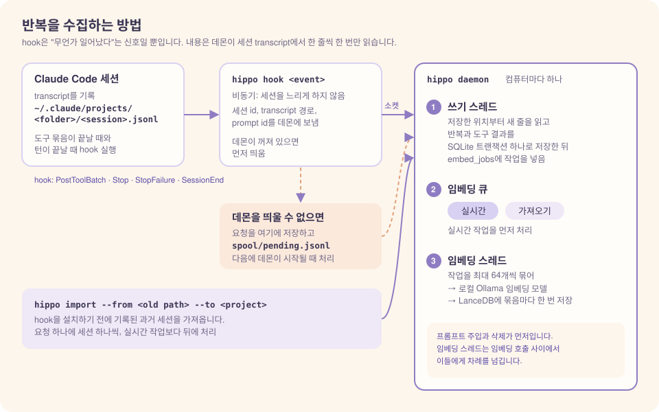
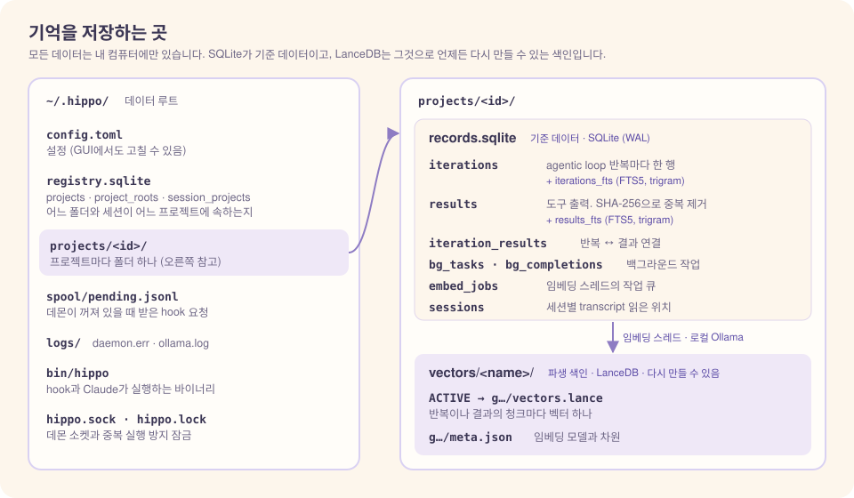
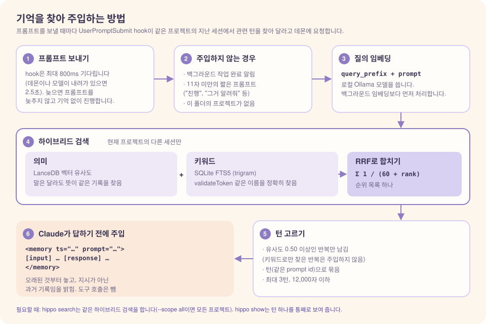

# Hippocampal Index (해마 색인, `hippo`)

**Claude Code 세션을 위한 장기 기억.**

[English](README.md)

`hippo`는 Claude Code에 내 세션의 장기 기억을 만들어 줍니다. agentic loop의 반복을 하나씩 로컬 DB에 기록해 두었다가, 새 프롬프트를 보내면 관련된 과거 맥락을 찾아 Claude에게 전달합니다. 설치와 관리는 macOS 앱(`hippo.app`)의 창에서 합니다.

모든 데이터는 내 컴퓨터 안에만 있습니다. 임베딩은 로컬 Ollama 모델로 만들고, 벡터는 임베디드 LanceDB에 저장합니다. 대화 내용은 외부로 나가지 않습니다.

---

## 이름과 개념

이름은 *해마 색인 이론*(hippocampal memory indexing theory, Teyler & DiScenna, 1986)에서 따왔습니다. 이 이론에 따르면 해마는 기억 전체를 저장하지 않습니다. 대뇌피질에 흩어진 기억 흔적을 가리키는 **색인**을 저장해 두었다가, 단서가 들어오면 그 색인으로 원래 기억을 다시 활성화합니다.

`hippo`도 같은 방식으로 동작합니다.

| 뇌 | `hippo` |
|----|---------|
| 대뇌피질의 기억 흔적 | SQLite에 저장한 원문 기록 |
| 해마의 색인 | 원문을 가리키는 벡터 저장소 |
| 단서 | 새로 보낸 프롬프트 |

줄여서 부르는 이름과 명령어는 `hippo`입니다.

---

## 한눈에 보기

### 1. 기록합니다

Claude Code hook이 agentic loop의 반복이 끝날 때마다 데몬에 알립니다. 데몬은 세션 transcript를 읽어 비밀값을 가린 뒤 저장하고, 백그라운드에서 임베딩을 만듭니다. hook은 비동기로 실행되므로 세션이 느려지지 않습니다.

### 2. 프로젝트별로 저장합니다

기억은 프로젝트(git 저장소 또는 폴더)마다 따로 저장합니다. 원문은 SQLite에 두고, 벡터 저장소는 원문에서 파생된 색인입니다. 그래서 임베딩 모델을 바꿔도 색인만 다시 만들면 됩니다.

### 3. 떠올립니다

프롬프트를 보낼 때마다 같은 프로젝트의 다른 세션에서 관련된 턴을 찾아 `<memory>` 블록으로 주입합니다. 검색은 벡터 유사도와 키워드 검색(FTS5)을 함께 씁니다. Claude가 더 찾아봐야 할 때는 `hippo search`와 `hippo show`를 직접 실행합니다.

---

## 빠른 시작

1. Ollama를 설치해 서비스로 띄우고 임베딩 모델을 받습니다: `brew install ollama && brew services start ollama && ollama pull qwen3-embedding:0.6b`
2. [Releases](https://github.com/Biisairo/Hippocampal-Index/releases)에서 앱을 받아 엽니다.
3. 앱 창의 **Claude 적용** 탭에서 **미리 보기**를 누른 뒤 **적용**을 누릅니다.
4. Claude Code 세션을 새로 시작합니다.

자세한 순서와 주의할 점(격리 속성 지우기 등)은 [시작하기](docs/ko/getting-started.md)를 보십시오.

---

## 문서

| 문서 | 내용 |
|------|------|
| [시작하기](docs/ko/getting-started.md) | 요구 사항, 앱 설치, Claude에 적용, 업데이트, 제거 |
| [GUI 사용법](docs/ko/usage.md) | 앱 창의 탭별 사용법(스크린샷 포함), 기록 지우기, 일시정지 |
| [CLI 참고](docs/ko/cli.md) | 터미널 명령 전체: `search`, `show`, `import`, `forget`, `install` 등 |
| [설정](docs/ko/configuration.md) | `config.toml`의 모든 키, 임베딩 모델이나 벡터 DB 바꾸기 |
| [구조와 동작](docs/ko/architecture.md) | 기억의 단위, 수집 방법, 저장 구조, 주입 규칙, 데몬 생명주기, 데이터 위치와 보안 |
| [문제 해결](docs/ko/troubleshooting.md) | 증상별 확인 사항, 알려진 한계 |
| [개발과 기여](docs/ko/development.md) | 스펙 작업 순서, 소스 구성, 빌드·테스트, 새 백엔드 추가, 이슈와 PR |
| [요구사항 명세(SRS)](docs/SRS.md) | 모든 동작의 기준 문서(ISO/IEC/IEEE 29148) |

---

## 라이선스

MIT입니다. [LICENSE](LICENSE)를 보십시오.
