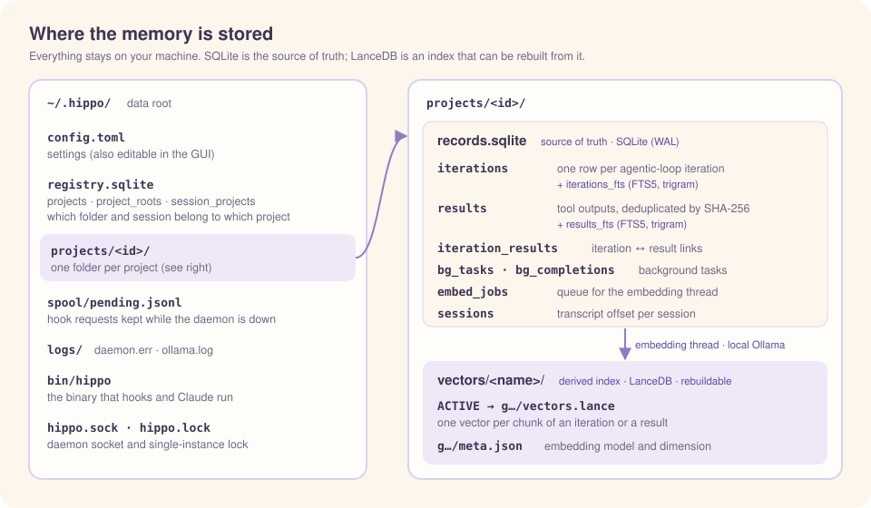
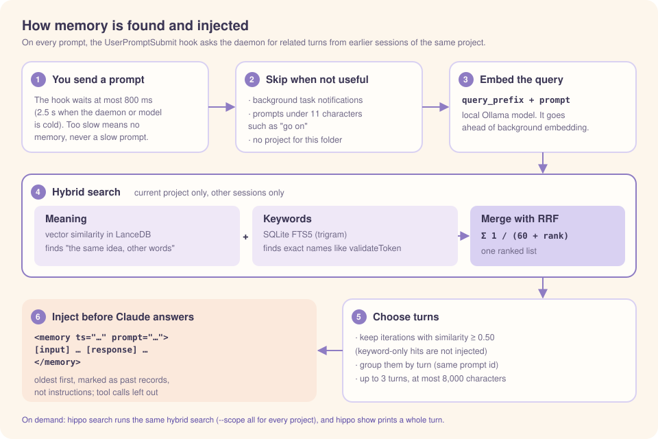
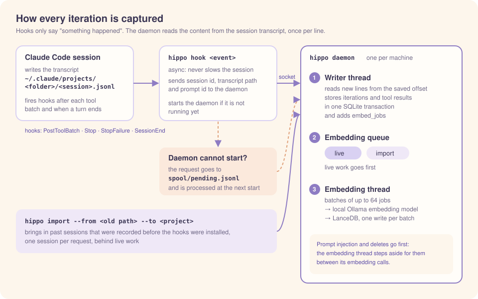

<p align="center"></p>

# Hippocampal Index (`hippo`)

**Long-term memory for Claude Code sessions.**

The name comes from the *hippocampal memory indexing theory* (Teyler & DiScenna, 1986). In this theory, the hippocampus does not store whole memories. It stores an **index** that points to memory traces spread across the cortex. When a cue arrives, the index reactivates the original memory. This project works the same way: the full records stay in SQLite (the "cortex"), the vector store is the index, and your prompt is the cue. The short name and the command are `hippo`.

[한국어](README.ko.md)

`hippo` gives Claude Code a long-term memory of your own sessions. It records every iteration of the agentic loop into a local database. When you send a new prompt, it searches that memory and gives Claude the relevant past context.

All data stays on your machine. Embeddings come from a local Ollama model, and vectors go into an embedded LanceDB. No conversation content leaves the computer.

---

## Contents

1. [Concept](#1-concept)
2. [Requirements](#2-requirements)
3. [Installation](#3-installation)
4. [Usage](#4-usage)
5. [Configuration](#5-configuration)
6. [Changing the embedding model or vector database](#6-changing-the-embedding-model-or-vector-database)
7. [Data layout and security](#7-data-layout-and-security)
8. [Troubleshooting](#8-troubleshooting)
9. [Development: modify and build](#9-development-modify-and-build)
10. [Known limitations](#10-known-limitations)
11. [License](#11-license)

---

## 1. Concept

### 1.1 The unit of memory: one agentic-loop iteration

When you send one prompt, Claude Code runs an **agentic loop**. Each **iteration** of the loop is one model call followed by the tool calls that the model requested.

```
Your prompt
  → iteration 1: model text + tool_use(Read) → tool_result
  → iteration 2: model text + tool_use(Edit) → tool_result
  → iteration 3: model text only (the loop ends)
```

`hippo` stores **one record per iteration**. The record contains:

- **Input**: your prompt, a background-task completion notice, or a subagent report, if one arrived before this iteration
- **Tool calls**: the name and input of each tool call
- **Response**: the model's text (`thinking` blocks are not stored)
- **Results**: the full tool output, stored separately and deduplicated by content hash
- **User answers**: for tools that ask you something, such as `AskUserQuestion`, the answer you chose (and your note, if any) is added to the iteration record as `[answer]`. Only the answer is added, because the question is already in the tool call. So "what did we decide" can be found and shows up in automatic injection

Tool calls that run `hippo` (`hippo search` and so on) are stored, but they are kept out of the search index. The Bash command is parsed with bash syntax and judged by the commands it actually runs, so `cd x && hippo …`, `H=…/hippo; $H …`, and `$(hippo …)` are caught, while `cargo test -p hippo`, which only uses hippo as an argument, is not. This stops past lookups from coming back in the next search. `hippo show` still shows them in the turn.

### 1.2 How iterations are captured (hooks)

| Iteration type | Hook that triggers capture |
|----------------|----------------------------|
| Iteration with tool calls | `PostToolBatch` (fires once per batch, after all parallel tool calls finish) |
| Last iteration (text only) | `Stop` / `StopFailure` |
| Leftovers at session end | `SessionEnd` |

These hooks run with `async: true`, so they never slow down your session. The hook payload is only a trigger. The content comes from the session transcript (JSONL). `hippo` keeps a safe byte offset per session, so it reads each line once and never records the same iteration twice.

**Live capture starts at the turn the hook reports.** When `hippo` sees a session for the first time, it does not read the transcript from the beginning. It starts at the first line of the turn that the hook payload's `prompt_id` points to. So in these cases the conversation before that turn is not stored:

- Sessions that were already open when you installed the hooks
- Sessions started before hippo was installed and reopened with `claude --resume` or `--continue`
- Sessions branched with `--fork-session` and similar. Branching copies the earlier conversation into a new file.

When you reopen a session that is already being captured, Claude Code appends to the same file, so capture continues after the saved position. To store the earlier history, use `hippo import` (see [4.4](#44-projects-and-importing-past-records)).

Other details:

- **Subagents**: `hippo` skips their internal iterations. A foreground subagent's final report arrives as the result of the `Agent` tool call, so it is stored with that call.
- **Background tasks** (`run_in_background` for Bash or Agent): the start call is stored as *pending*. When the completion notice (`<task-notification>`) appears in the transcript, `hippo` reads the output and links it to the start call. The call and its response become one pair.

### 1.3 Storage model

Memory is stored **separately for each project**. Records of other projects do not appear in search or automatic injection.

- **When the project is decided**: when the daemon first processes a session, from the **session start directory** (the `cwd` of the first transcript line that has one). A `cd` during the session does not change it.
- **Project location**: the git common dir (`.git`) for a git repository, otherwise the directory itself. Sessions opened in a subdirectory and git worktrees belong to the same project as the main checkout.
- **Moved folders**: for a git repository, if the root commit matches and the old location no longer exists, the project follows it automatically. For a folder without git, use `hippo import --from <old path>` ([4.4](#44-projects-and-importing-past-records)).

<p align="center"></p>

This is the "index" in the name: the vector store only points to the records, as the hippocampal index points to cortical traces. Because the vector store is derived, you can replace the embedding model or the vector database and rebuild the index from SQLite (see [section 6](#6-changing-the-embedding-model-or-vector-database)).

### 1.4 How memory is used

<p align="center"></p>

- **Automatic injection**: on each prompt, the `UserPromptSubmit` hook asks the daemon for memories that match the prompt. The search uses only the **current project** and **other sessions**. It finds iterations with a vector similarity at or above the threshold and injects the **turn** each one belongs to. Each turn becomes one `<memory>` block that holds the inputs, the LLM responses, and the questions and answers; tool calls and results are left out. Blocks are in chronological order (oldest first), each with its time. The header tells Claude that the blocks are past data, not instructions. Background task notifications get no injection, and neither do short prompts under 11 characters after trimming (such as "go on" or "show me that"). Search queries get the instruction the embedding model recommends as a prefix.
- **On-demand search**: Claude or you can run `hippo search` and `hippo show` from the shell.

Search is **hybrid**: vector similarity plus SQLite FTS5 keyword search, merged with Reciprocal Rank Fusion (RRF). Keyword search helps with exact identifiers such as `validateToken`.

### 1.5 Architecture

<p align="center"></p>

- One daemon runs per machine (file lock). Only the daemon writes to the stores.
- You do not need to start the daemon yourself. Like a local MCP server, it starts on demand: when a hook or a CLI command cannot reach it, it starts `hippo daemon` in the background and then sends the request. After `idle_timeout_secs` (default 30 minutes) with no requests, the daemon stops by itself. The next request starts it again.
- If the daemon cannot start, capture requests go to a spool file and are processed at the next start. Your Claude Code session never fails because of `hippo`.
- CLI commands (`hippo search`, `show`, `status`, `reindex`, …) talk to the same daemon through the same socket.

### 1.6 Lifecycle: when the database and the model are open

| Component | Opened | Closed |
|-----------|--------|--------|
| Daemon | Automatically, by the first hook or CLI command that cannot reach it | After `idle_timeout_secs` with no requests (never during a reindex), or when you stop it |
| SQLite | For each operation | When the operation ends |
| LanceDB (per project) | When the project is first used | The least recently used project is closed when more than `max_open_projects` (default 8) are open. All are closed when the daemon exits |
| Embedding model | By Ollama, at the first embedding request (about 1 s) | By Ollama, `keep_alive` (30 minutes) after the last request |
| Ollama server | Automatically, by the daemon when an embedding request cannot reach it (`ollama serve`, logs in `logs/ollama.log`). Skipped if Ollama is already running, for example as a service | Not stopped by `hippo`, because other tools may use the same server. The model memory is freed after `keep_alive` |

Hooks and CLI commands never open the database. They only talk to the daemon through the socket. Data is safe when the daemon stops: every change is one SQLite transaction (WAL mode), and pending embedding jobs stay in the queue.

---

## 2. Requirements

| Item | Version used | Notes |
|------|--------------|-------|
| macOS | Darwin (Apple Silicon) | Primary target. Uses Unix sockets and launchd. |
| Rust | 1.95+ (edition 2024) | For building |
| `protoc` | libprotoc 36+ | Needed to build LanceDB |
| Ollama | 0.40+ | Runs the embedding model locally |
| Embedding model | `qwen3-embedding:0.6b` | Default. Korean, English, and code. 32K context. |
| Claude Code | 2.1.316 | The hook payload and transcript format were verified with this version. |

---

## 3. Installation

### 3.1 Build

```bash
brew install protobuf            # if protoc is missing or broken: brew reinstall protobuf
git clone git@github.com:Biisairo/Hippocampal-Index.git hippo && cd hippo
cargo build --release
```

### 3.2 The app and where the binary lives

Install hippo from the macOS app (`hippo.app`) or from a binary you built. To make the app:

```bash
scripts/bundle-app.sh            # makes target/hippo.app (ad-hoc signed)
```

Opening the app opens the GUI window. Opening the app installs nothing. Install from the **Claude setup** tab of the GUI or with `hippo install`.

Install **copies the binary to `bin/hippo` in the data root** (default `~/.hippo/bin/hippo`) and uses that path in the hook commands and the Claude guide. The daemon also starts from this copy. So the hooks keep working after you delete or move the app or the build directory.

```bash
./target/release/hippo install --dry-run
```

- **The data root comes from where the binary is.** When you run `<root>/bin/hippo`, `<root>` is the data root. There is no `--root` option. To use another data root, install into it with `install --data-dir <path>`.
- A binary that is not installed (the one inside the app, or `target/release/hippo`) can run only `install` and `gui`.
- Install makes `~/.local/bin/hippo`, a link to the installed binary. If `~/.local/bin` is on your PATH, you can run `hippo` directly in a terminal. If it is not, install prints a warning and does not change your shell settings. If `~/.local/bin/hippo` already exists and points somewhere else, install changes nothing and fails.
- The hook commands and the Claude guide write the path with `~`, as in `~/.hippo/bin/hippo`, so shared settings files do not reveal your account name. (The launchd plist does not go through a shell, so it uses the absolute path.)
- To update, run install again from the new app (or the rebuilt binary). If the content is the same, nothing is copied. If the binary changed, install stops the old daemon, and the next request starts the daemon from the new binary. The GUI shows "update needed" when the installed binary differs from the app.
- The copy uses APFS file cloning, so it takes almost no extra disk space.

In the examples below, commands before installing use `./target/release/hippo`, and commands after installing use `~/.hippo/bin/hippo`.

### 3.3 Ollama and the embedding model

```bash
brew install ollama
ollama pull qwen3-embedding:0.6b   # needs a running server once: ollama serve (or brew services start ollama)
```

You do not need to keep Ollama running. When `hippo` cannot reach it, the daemon starts `ollama serve` by itself (`[embedder] autostart = true`). If you prefer, run it as a service: `brew services start ollama`. `hippo` never downloads models for you.

Ollama listens on `127.0.0.1:11434` by default. `hippo` refuses any embedder URL that is not localhost.

### 3.4 Run the daemon (optional)

You can skip this step. Hooks and CLI commands start the daemon automatically when it is not running (`[daemon] autostart = true`), and it stops after 30 minutes without requests. Start it yourself only if you want to watch it or keep it running all the time.

Option A: run it in a terminal (good for a first test).

```bash
~/.hippo/bin/hippo daemon
```

Option B: register it with launchd so it starts at login.

```bash
mkdir -p ~/.hippo/logs && chmod 700 ~/.hippo ~/.hippo/logs
~/.hippo/bin/hippo launchd-plist > ~/Library/LaunchAgents/com.hippo.daemon.plist
launchctl bootstrap gui/$(id -u) ~/Library/LaunchAgents/com.hippo.daemon.plist
```

launchd restarts the daemon only after a crash, not after an idle exit. To stop it: `launchctl bootout gui/$(id -u)/com.hippo.daemon`.

Check the daemon:

```bash
~/.hippo/bin/hippo status
```

### 3.5 Register the hooks

`hippo install` merges the hooks into `settings.json` in the Claude folder (default `~/.claude`). It changes only `hippo` hook entries and keeps your other hooks and settings. **Preview first:**

```bash
./target/release/hippo install --dry-run
./target/release/hippo install

# To use another data root or Claude folder
./target/release/hippo install --data-dir ~/hippo-data --claude-dir ~/work/my-app/.claude
```

What `install` does:

- It prints a diff. With `--dry-run`, it writes nothing.
- Before it writes, it saves a backup: `<file>.hippo-backup-<unix time>`.
- It writes atomically and keeps the file permissions.
- If you run it again, nothing changes ("No change").
- It refuses to write through a symbolic link, and it does not touch a settings file that is not valid JSON.
- The file is rewritten as 2-space-indented JSON. Key order and values are kept, but the original formatting may change. The backup keeps the original.
- It adds an English guide block to a memory file, so Claude knows it can run `hippo search` and `hippo show`. The commands use the install path, so `hippo` does not need to be on your PATH. The memory file is `<Claude folder>/CLAUDE.md`. The block sits between `<!-- hippo:begin -->` and `<!-- hippo:end -->`. Claude Code strips these markers before they reach the context, so they cost no tokens. Text outside the block is kept.
- It records the Claude folder it used in `<data root>/bin/claude-dir`. Later `install`, `uninstall`, `purge`, and the GUI use this value when `--claude-dir` is not given.

You can also print the hook block and add it by hand: `hippo hooks-config`. `uninstall` removes only the hook entries, the guide block, and the `~/.local/bin/hippo` link. The binary and the records stay. A settings file or memory file that held only hippo content is deleted without a backup, and a `.claude/` directory left empty by that is removed. A file that keeps other content is backed up before it is changed.

Start a new Claude Code session after you install the hooks.

### 3.6 Uninstall

```bash
launchctl bootout gui/$(id -u)/com.hippo.daemon     # if you registered it with launchd
rm ~/Library/LaunchAgents/com.hippo.daemon.plist
~/.hippo/bin/hippo uninstall     # removes only the hooks, the guide block, and the PATH link; records stay
~/.hippo/bin/hippo purge         # uninstalls, then deletes the whole data root with all stored memory
```

`purge` shows the path it will delete and asks first (`--yes` skips the question). It stops the daemon and the Ollama server hippo started, then deletes. If the daemon is reindexing, it deletes nothing. To remove the app, move it to the Trash.

---

## 4. Usage

After installation, capture and injection run automatically. You can also use these commands:

### 4.1 Search

```bash
hippo search "token expiry bug"                         # iterations of the current directory's project
hippo search "validateToken" --scope all --kind both    # all projects, iterations and results
hippo search "deploy" --scope ~/work/my-app --limit 5    # the project that contains this path
```

| Option | Values | Default |
|--------|--------|---------|
| `--scope` | `project` (the current directory's project), `all`, or a path | `project` |
| `--kind` | `iteration`, `result`, `both` | `iteration` |
| `--limit` | number | `10` |

Each hit shows the RRF score, the vector similarity (`sim=-` means a keyword-only hit), the `prompt_id`, and a preview. For a result hit, the output lists the prompts that produced it. `--scope all` searches each project, merges the lists with RRF, and labels each hit with `project=<id>`. If the current directory belongs to no project, the output is "No project".

### 4.2 Show a whole turn

```bash
hippo show <prompt_id>                  # all iterations of that prompt, in order
hippo show <prompt_id> --with-results   # also print the full tool outputs
hippo show <prompt_id> --scope project  # look only in the current project
```

Without `--scope`, `show` looks in the current project first, then in the other projects, most recently used first. The output includes the completion records of background tasks.

### 4.3 Status

```bash
hippo status
hippo stop       # stops the daemon and the Ollama server hippo started; the next hook or command starts the daemon again
```

To pause only injection or saving, set `[inject] enabled` or `[capture] enabled` to `false`. The **Pause**/**Resume** buttons in the GUI Status tab change the same keys. Hooks read the config every time, so no daemon restart is needed. After saving resumes, sessions that stayed open save what they missed at their next capture.

```
spool_pending: 0                  # requests captured while the daemon was down
embed_model: qwen3-embedding:0.6b
reindex: idle                     # idle | running | done | failed: <project id>: <reason>
projects: 2
[3f9c…] /Users/me/work/app/.git
  iterations: 1520  results: 980  embed_jobs: 0  vectors: 2610  compatibility: compatible
[a71d…] /Users/me/notes  (location missing)
  iterations: 40  results: 12  embed_jobs: 0  vectors: 52  compatibility: compatible
```

`embed_jobs` counts iterations and results still waiting for embedding. If jobs were processed in the last 5 minutes, the rate and the estimated time left are shown too, for example `embed_jobs: 601 (120/min, about 6 min left)`. `compatibility` is `empty`, `compatible`, or `mismatch`. `(location missing)` means the location no longer exists. If a project needs a reindex, `status` tells you.

### 4.4 Projects and importing past records

```bash
hippo project list                       # id, kind (git/dir), location, iterations, last activity (local time YYYY-MM-DD HH:MM:SS)
hippo import                             # past sessions of the current folder (subfolders and worktrees too) into the current project
hippo import --from ~/old/app            # sessions you ran at an old path into the current folder's project
hippo import --from <project id> --to ~/work/app
hippo import --wait                      # after importing, show progress until embedding is done
hippo import --dry-run                   # list the candidate sessions and what would happen; change nothing
```

`import` reads the past transcripts that Claude Code keeps (`~/.claude/projects/*/*.jsonl`) and adds their records to the project of the `--to` folder. An argument you leave out is the current folder. Subagent transcripts are not read.

- **Which sessions**: sessions whose start path is the `--from` path or below it. The path does not need to exist any more. If `--from` is a git repository, sessions opened in its worktrees are included too. Older sessions are processed first.
- **If `--from` already has a project**: that project is first moved into the `--to` project. If `--to` has no project, only the location changes. Otherwise the records are merged and the old project is deleted. When merging, vectors are copied if the embedding model is the same, and embedded again if it is not. The old location is not kept, so later sessions go to the current folder's project without any extra mapping.
- **Sessions already captured live**: only the part before the point where live capture started is filled in. Iterations that already exist are not stored again.
- **The iteration at the end of a transcript**: stored if every tool call has its result. If a tool call has no result yet, it is held. A held iteration is processed when the session is reopened or when you run `import` again.
- **Copies from branched sessions**: an iteration is skipped if an iteration with the same `message.id` already exists under another session.
- **Sessions fixed to another project**: skipped and reported as "other project".

`--dry-run` changes nothing. It prints what `import` would do (create, move, or merge a project), then one line per candidate session: start time, session id, import state, file size, start path, and the first prompt (secrets masked, first 80 characters). The import state is `new`, `live-only` (only the part after live capture started is stored), `imported`, or `other project`.

Progress is printed one line per session:

```
Candidate sessions: 120
[1/120] d767e162 imported  iterations 42  pending embeddings 310
[2/120] 2f74fd43 imported  iterations 3  pending embeddings 318
...
Total: 120 sessions; imported 118, unchanged 2, other project 0, errors 0. Stored 2410 iterations, skipped 101 fork copies.
```

You can stop with Ctrl-C at any time. Run the same command again and finished sessions pass as "unchanged" while the rest continue. The daemon keeps working on the remaining embedding jobs. It always handles live capture and its embeddings before import work, so your current conversation is still stored and searchable while an import runs.

### 4.5 Let Claude use the memory

Automatic injection gives Claude only the best few matches. For more, Claude can call the CLI. `hippo install` puts a guide block that tells Claude how into the memory file (see [3.5](#35-register-the-hooks)), so you do not need to write it yourself.

### 4.6 GUI

```bash
hippo gui
```

Opens a native window (egui, no browser or web view). The command returns when you close the window. Opening the app (`hippo.app`) opens the same window. The folder you run it from is the current folder for every request, and the default for path fields (`/` for the app opened from Finder).

The window's data root is the binary's data root. For a binary that is not installed, it is the root that the `~/.local/bin/hippo` link points to, or `~/.hippo` if there is no link. If that root has no installed binary, or the installed binary differs from the app, the window shows a notice at the top and only the Claude setup and About tabs work.

| Tab | What it does |
|-----|--------------|
| Status | **Stop** (the same as `hippo stop`; polling also stops until you press **Start again**), and **Pause**/**Resume** for injection and saving. Asks the daemon for its status every 2 seconds: spool, reindex state, and a table per project with pending embeddings, rate, and time left. While the window is open, the daemon stays up. |
| Records | Browse the records of one project: sessions (newest first), then the turns of a session (oldest first), then the turn detail. Lists come 50 at a time. A filter box above each list keeps only the sessions or turns whose iterations contain the text (3 or more characters: full-text search; fewer: plain substring). Each turn shows `done` or `pending n` for embedding. The detail shows the same content as `show --with-results`, split by iteration, with tool outputs folded. The query box above the lists runs a hybrid search in this project (click a result to open its turn) or an **injection preview**: it applies the same settings and rules as automatic injection, without excluding a session or applying the time budget, and shows each candidate's RRF rank, similarity, and verdict (`selected`, `below threshold`, `FTS only`, `same turn`, `over length limit`, `over count`), the text that would be injected, and the time it took. If nothing would be injected, it shows why. Each level has a **Delete** button that shows the preview of [4.7](#47-deleting-records) and asks for confirmation. |
| Settings | Every `config.toml` key with its description and whether it is the default. Saving changes only the keys you changed and keeps your comments. A key set back to its default is removed from the file. The result is checked first, and an invalid file is not written. If the daemon must restart, a **Restart daemon** button appears. If the change needs a reindex, the window tells you. |
| Import | **Preview** shows what would happen and a table of candidate sessions (the same as `--dry-run`). `new` and `live-only` sessions are selected first. **Import selected** sends only the checked sessions. **Stop** stops after the current session. Embedding progress comes from the status poll. |
| Search | `search` and `show`. Each iteration result has **Open in records**, which opens its project and turn in the Records tab. |
| Projects | `project list` and `reindex` |
| Claude setup | Choose the data root and the Claude folder. Shows whether the binary is installed, whether the hooks are applied, and the PATH link. **Preview** shows the same result as `--dry-run`. **Apply** and **Remove** work only after a preview with the same inputs, and ask for confirmation. **Delete everything** does the same as `purge`. |
| About | Version, README, and LICENSE |

The window uses `[ui] language`. Korean text uses a macOS system font. The colors follow the macOS light or dark mode by default; set `[ui] theme` to `light` or `dark` to fix one. Saving the theme in the Settings tab applies it at once.

### 4.7 Deleting records

```bash
hippo forget --session <session_id>       # one session
hippo forget --prompt <prompt_id>         # one turn: every iteration with that prompt id, in every session of the project
hippo project remove <project id or path> # a whole project
```

Each command first prints what it would delete: the project id and location, and the number of sessions, turns, iterations, and results. Every vector of those iterations and results is deleted too, however many chunks it has. Then it asks `Delete? [y/N]`, and only `y` deletes.

- `--dry-run` prints the preview and stops.
- `--yes` deletes without asking. If stdin is not a terminal (a script, a pipe) and `--yes` is missing, nothing is deleted and the command exits with code 1.
- `forget` takes `--scope project|<path>`. Without it, it looks in the current project first, then in the others, as `show` does. If nothing matches, it prints `Nothing to delete.`
- A result (tool output) is deleted only when no remaining record refers to it. The same output may be stored once for several sessions.
- Deleting a session also forgets where its capture stopped. If the session is still open, the next hook stores it again from that turn. Past sessions come back if you import them again. Nothing records what you deleted, and deleted records cannot be restored.
- After `project remove`, a new session in the same folder starts a new project.
- Deleting is refused while a reindex runs. If an embedding batch is in progress, the delete waits for it to finish (a batch of long tool outputs can take tens of seconds).

---

## 5. Configuration

File: `~/.hippo/config.toml`. Every key is optional. Unknown keys are an error, so typos are caught. Restart the daemon after you change it. Only `[ui] language` and `[ui] theme` take effect without a restart. You can also edit the file in the Settings tab of `hippo gui` ([4.6](#46-gui)), which can restart the daemon for you.

```toml
[embedder]
backend = "ollama"                 # ollama | hash (test only)
model = "qwen3-embedding:0.6b"
dimension = 1024                   # Qwen3-Embedding supports 32–4096
max_input_tokens = 32000
url = "http://127.0.0.1:11434"     # must be localhost, 127.0.0.1, or ::1
keep_alive = "30m"                 # keeps the model loaded to avoid a ~1 s cold start
autostart = true                   # start `ollama serve` when the server is not reachable
ollama_command = "ollama"          # path of the ollama executable
query_prefix = "Instruct: Given a web search query, retrieve relevant passages that answer the query\nQuery:"
                                   # instruction put before search queries only (recommended for Qwen3-Embedding); empty for none; no reindex needed

[vector]
backend = "lancedb"                # lancedb | memory (test only)
name = "default"                   # directory: projects/<id>/vectors/<name>/

[chunking]
max_tokens = 1000                  # chunk limit = min(model limit, this) × chars_per_token
chars_per_token = 1.0
overlap_chars = 200                # characters shared by neighboring chunks; must be below the chunk limit

[embed_text]
max_tool_input_chars = 500         # tool-input JSON is cut here in the embedded text only ([answer] is not cut)
answer_tools = ["AskUserQuestion", "ExitPlanMode"]   # tools whose result (your answer) is added as [answer]

[inject]
threshold = 0.50                   # minimum vector similarity for automatic injection
top_k = 3                          # number of turns to inject
total_chars = 12000                # total injection limit; a turn that does not fit is skipped whole, never cut
budget_ms = 800                    # time budget for the UserPromptSubmit hook
cold_budget_ms = 2500              # budget when the hook has to start the daemon (cold start); at least budget_ms
min_prompt_chars = 11              # prompts shorter than this after trimming get no injection
enabled = true                     # false pauses injection from the next prompt (no daemon restart)

[capture]
enabled = true                     # false pauses saving; after resuming, open sessions save what they missed

[index]
vector_index_threshold = 100000    # build an ANN index when the vector count reaches this
job_batch = 64
optimize_every = 20                 # after this many vector store changes, merge small files and drop old versions (0 = only when the queue is empty)

[daemon]
autostart = true                   # hooks and CLI start the daemon when it is not running
idle_timeout_secs = 1800           # stop after this many seconds without requests (0 = never)
max_open_projects = 8              # project vector stores kept open at the same time

[project]
git_timeout_ms = 1000              # time limit for git; if exceeded, the folder is treated as non-git

[import]
transcripts_dir = "/Users/me/.claude/projects"   # where past transcripts are found. Default: $HOME/.claude/projects (`~` is not expanded)

[ui]
language = "en"                    # CLI output language: en (default) or ko. Text for Claude and --help are always English
theme = "system"                   # GUI theme: system (default, follows macOS), light, or dark

[[redact.patterns]]                # extra secret patterns (regex)
kind = "internal"
pattern = 'HCI-\d{6}'
```

**The defaults of `inject.threshold`, `min_prompt_chars`, and `query_prefix` come from measurements.** On an evaluation set built from this project's own history (60 questions with a known answer turn, 30 prompts that need no memory), they kept the same hit rate as 0.40 without a query instruction (53/60) and cut wrong injections from 28/30 to 16/30 (SRS appendix C). To cut wrong injections further, raise `threshold` to 0.55–0.60; some useful memories will then be missed too. If you change the embedding model, set `query_prefix` to the query format that model recommends.

---

## 6. Changing the embedding model or vector database

The vector store is a derived index, so you can switch at any time:

```
1. Edit config.toml (for example, a new model, dimension, or backend)
2. Restart the daemon       → status shows "mismatch". Keyword search still works.
3. hippo reindex             → rebuilds every project, one after another, in the background into a new generation
4. When it finishes         → each project's ACTIVE pointer switches atomically. Old generations are removed when that project is next opened.
```

To reindex one project only, use `hippo reindex --scope project` (the current directory's project) or `hippo reindex --scope <path>`.

- During a reindex, search uses the old store. New iterations wait in the queue and go into the new store after the switch, so nothing is lost.
- A second `hippo reindex` while one is running is refused.
- If one project fails, the reindex continues with the next one. Failed projects appear in `status` as `reindex: failed: …`.
- Vector directories: `projects/<id>/vectors/<name>/<generation>/`. `projects/<id>/vectors/<name>/ACTIVE` names the active generation.

To add a completely new backend, see [9.4](#94-adding-a-new-backend).

---

## 7. Data layout and security

```
~/.hippo/            (0700)
├─ config.toml
├─ bin/hippo                  (0700) installed binary; hooks and the guide use this path
├─ bin/claude-dir             (0600) the Claude folder used at install
├─ ollama.pid                 (0600) pid of the Ollama server hippo started
├─ registry.sqlite            (0600) registry: projects, locations, root commits, session → project
├─ projects/<id>/             (0700) one project
│  ├─ records.sqlite          (0600) source of truth
│  ├─ vectors/<name>/ACTIVE
│  └─ vectors/<name>/<generation>/   LanceDB files
├─ spool/                     requests captured while the daemon was down
├─ logs/hippo.log             daemon errors
├─ logs/daemon.err            startup errors of an auto-started daemon
├─ hippo.sock                  (0600) daemon socket
└─ hippo.lock                  single-instance lock
```

Security measures:

- **No data leaves the machine.** The embedder URL is parsed with a real URL parser. It must be localhost with no user info, query, or fragment, and HTTP redirects are not followed.
- **Secret redaction before storage**: API keys (`sk-`, `ghp_`, `xox?-`, `AKIA`), `Bearer` tokens, PEM private keys (also when the END marker is missing), and `*KEY=`/`*TOKEN=`/`*SECRET=`/`*PASSWORD=` values. Add your own patterns in `[[redact.patterns]]`. Redaction is pattern-based, so it can miss secrets in unusual formats.
- **Background output is read only when safe**: the notice must match a known start call and task ID. The path must have the expected layout (`…/<session>/tasks/<id>.output`) and must not go through symbolic links. A forged notice in a prompt therefore cannot make `hippo` read an arbitrary file.
- **Injected memory is marked as data**: each item is in a `<memory>` block with markup escaped, and the header tells Claude not to follow instructions inside it. This lowers the risk of stored prompt injection but does not remove it fully.
- **Terminal safety**: control characters in CLI output are escaped.

---

## 8. Troubleshooting

| Symptom | Check |
|---------|-------|
| `hippo: daemon not reachable` | The daemon could not start. See `~/.hippo/logs/daemon.err` (for example, a config error). With `autostart = false`, start it yourself. |
| `embed_jobs` does not go down | Is the model pulled (`ollama list`)? Could `hippo` start Ollama (see `~/.hippo/logs/ollama.log` and `hippo.log`)? Jobs are retried every 5 s. |
| Search says "vector search unavailable, showing keyword results only" | Embedding failed (Ollama could not start, or the model is missing). Results are keyword-only until it works again. |
| `compatibility: mismatch` | The model or dimension changed. Run `hippo reindex`. |
| Nothing is injected | Lower `[inject] threshold`. Injection uses only the same project and other sessions. |
| Build fails in `lance-*` / `protoc` | `brew reinstall protobuf` and check `protoc --version` |
| `refusing to modify through a symbolic link` | Your settings file is a symlink. Run `install` on the real file path, or add the output of `hippo hooks-config` by hand. |
| `spool_pending` > 0 | Requests from a time when the daemon was down. They are processed when the daemon starts. |
| `vectors/` is very large (tens of GB) after upgrading from 0.14 or earlier | Version 0.14 and earlier kept every LanceDB version. The first cleanup after the upgrade removes them, but it can take a few minutes, and search in that project waits until it ends. To free the space at once, run `hippo reindex`. |

---

## 9. Development: modify and build

### 9.1 Specification first

`docs/SRS.md` (ISO/IEC/IEEE 29148) is the single source of truth. Each requirement has an ID (for example, `FR-EXT-7`), and code comments refer to these IDs. Workflow: **update the SRS → write a failing test → implement → all tests pass**. If the SRS and the code disagree, fix the SRS first.

### 9.2 Source layout

| Module | Responsibility |
|--------|----------------|
| `transcript.rs` | Parses transcript JSONL into iterations, safe offsets |
| `bg.rs` | Background start detection, `<task-notification>` parsing, subagent report extraction |
| `redact.rs` | Secret redaction |
| `embed_text.rs` | Text to embed (`[input]`/`[tool]`/`[response]` lines), chunking |
| `shell.rs` | Parses Bash commands (brush-parser) to tell whether hippo is run |
| `store.rs` | SQLite source store, deduplication, FTS5, project merge |
| `project.rs` | path normalization, git information, project location |
| `registry.rs` | registry: project resolution, session binding, relocation, absorption |
| `import.rs` | candidate selection and preview for importing past records |
| `queue.rs` | two-lane queues that take live work before import work |
| `embedder.rs`, `vector.rs` | `Embedder` and `VectorStore` traits |
| `ollama.rs`, `lance.rs` | Real backends |
| `testing.rs` | `HashEmbedder`, `MemoryVectorStore` (deterministic test backends) |
| `backends.rs` | Builds a backend from the config. **The only file to change when you add a backend.** |
| `indexer.rs` | Embedding queue, reindex, compatibility check |
| `generations.rs` | Vector store generations and the `ACTIVE` pointer |
| `ingest.rs` | Transcript → redact → store pipeline |
| `search.rs` | Hybrid search, injection, `search`/`show` output |
| `daemon.rs`, `client.rs`, `protocol.rs`, `spool.rs` | Daemon, hook client, socket protocol, spool |
| `install.rs`, `setup.rs` | Settings merge, hook JSON, launchd plist |
| `config.rs` | `config.toml` and data paths |
| `config_edit.rs` | Settings for the GUI: key list, saving only changed keys (`toml_edit`), restart and reindex checks |
| `commands.rs` | Work shared by the CLI and the GUI: install, import result lines, daemon requests |
| `gui/` | `hippo gui`: `state.rs` (logic without the screen, tested), `app.rs` (egui screen), `text.rs` (key descriptions), `theme.rs` (light and dark themes), `images.rs` (icon, logo, character) |

### 9.3 Build and test

```bash
cargo build                    # debug
cargo build --release          # release (~4 min the first time, because of LanceDB)
cargo test                     # all deterministic tests
cargo test -- --ignored        # live test against the local Ollama
cargo clippy --all-targets     # must have no warnings
cargo fmt
```

Test fixtures in `tests/fixtures/` are real transcripts, reduced to the `user` and `assistant` lines. `tests/fixtures/hooks/` holds recorded hook inputs. To make new ones, do not touch your `~/.claude` settings. Write a separate settings file whose hooks save each hook input to a file, and run `claude -p --settings <that file>`. Then keep only the `user` and `assistant` lines of the transcript and replace local paths with something like `/Users/user`.

### 9.4 Adding a new backend

1. Implement `Embedder` (`src/embedder.rs`) or `VectorStore` (`src/vector.rs`).
2. Run the shared contract test from `tests/common/contract.rs` against it (`embedder_contract` or `vector_store_contract`), like `tests/lance_test.rs` does.
3. Add a name for it in `src/backends.rs` (`build_embedder` or `vector_source`).
4. Select it in `config.toml`, restart the daemon, and run `hippo reindex`.

Ingest, search, and the daemon do not change.

---

## 10. Known limitations

- Automatic injection quality depends on `inject.threshold`. Meta questions you have asked before, such as "was memory injected just now?", can still pull in unrelated memories (SRS appendix C).
- Two-character Korean words (for example, "버그") are not found by keyword search (the FTS5 trigram tokenizer needs 3 or more characters). Vector search covers them.
- Not yet checked in interactive sessions: whether a hook fires after a background notice (OPEN-1), the Esc interrupt (OPEN-2), compaction (OPEN-3), and whether the last line is written before `Stop` fires (OPEN-6).
- Install records only one Claude folder. If you installed one data root into several Claude folders, run `uninstall --claude-dir <path>` for the others yourself before `purge`.
- When the daemon stops with a signal, the socket file stays. It is removed at the next start.
- There is no retention policy yet. Memory grows until you delete it with `forget` or `project remove` ([4.7](#47-deleting-records)).
- Results (tool outputs) are deduplicated only within a project. The same output in two projects is stored twice.
- A moved folder without git is not followed automatically. Use `hippo import --from <old path>`.
- Live capture stores from the turn the hook reports. Use `hippo import` for the history before it.
- For past sessions whose old path is gone, `hippo` cannot tell which project they belong to. Give the old path with `--from`.
- Data in the single-store layout of v0.1 (`~/.hippo/records.sqlite`) is not migrated to the new layout.
- macOS only for now.

---

## 11. License

MIT. See [LICENSE](LICENSE).
