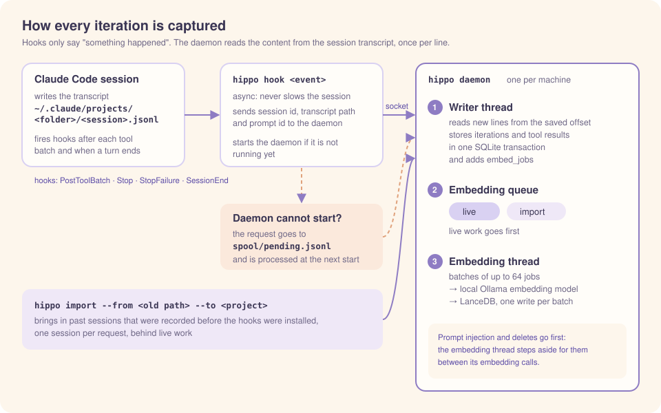
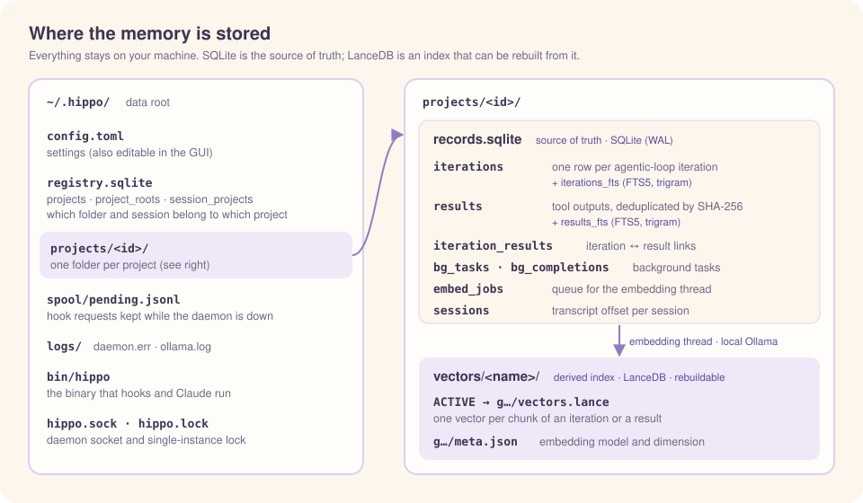
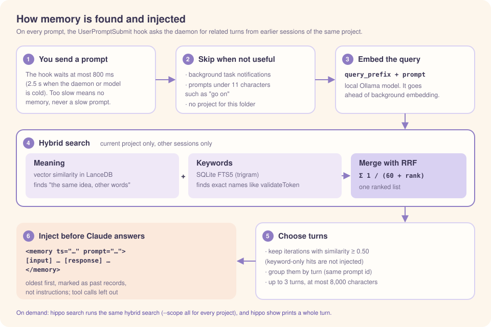

# Architecture

[← README](../../README.md) · [한국어](../ko/architecture.md)

This document explains what `hippo` records, how it stores it, and when it injects memory. The reference for all behavior is the [requirements specification (SRS)](../SRS.md).

## Contents

1. [The unit of memory: one agentic loop iteration](#1-the-unit-of-memory-one-agentic-loop-iteration)
2. [How iterations are captured (hooks)](#2-how-iterations-are-captured-hooks)
3. [Storage layout](#3-storage-layout)
4. [How memory is used](#4-how-memory-is-used)
5. [The daemon](#5-the-daemon)
6. [Lifecycle: when DBs and the model open and close](#6-lifecycle-when-dbs-and-the-model-open-and-close)
7. [Data location](#7-data-location)
8. [Security](#8-security)

---

## 1. The unit of memory: one agentic loop iteration

When you send a prompt, Claude Code runs the **agentic loop**. One **iteration** of the loop is one model call plus the tool calls the model asked for.

```
prompt
  → iteration 1: model text + tool_use(Read) → tool_result
  → iteration 2: model text + tool_use(Edit) → tool_result
  → iteration 3: model text only (loop ends)
```

`hippo` stores **one record per iteration**. The iterations from one prompt are called a **turn**. A record holds:

- **Input**: the prompt, background task notifications, and subagent reports that arrived just before this iteration
- **Tool calls**: the name and input of each tool called
- **Response**: the model's text (`thinking` is not stored)
- **Results**: the raw tool output. Stored separately and deduplicated by content hash
- **The user's answers**: for tools that ask the user, such as `AskUserQuestion`, the chosen answer (and note, if any) goes into the iteration record as `[answer]`. The question is already in the tool call, so only the answer is added. This makes "what was decided" searchable and visible in automatic injection

Tool calls that ran `hippo` (such as `hippo search`) are stored in the records but not in the search index. This keeps the act of looking up memory out of later searches.

- Bash commands are parsed with bash grammar to decide whether `hippo` actually runs.
- So `cd x && hippo …`, `H=…/hippo; $H …`, and `$(hippo …)` are caught, but `cargo test -p hippo`, where `hippo` is only an argument, is not.
- `hippo show` still shows them in the turn.

## 2. How iterations are captured (hooks)

<p align="center"></p>

| Iteration kind | Hook that triggers capture |
|----------------|----------------------------|
| Iterations that called tools | `PostToolBatch` (once per batch, after all parallel calls finish) |
| The last iteration (text only) | `Stop` / `StopFailure` |
| Anything left when the session ends | `SessionEnd` |

- These hooks run with `async: true`, so they do not slow down the session.
- The hook input is only a signal. The content is read from the session transcript (JSONL).
- `hippo` keeps a safe offset per session, so it never reads the same line twice or stores the same iteration twice.

### Live capture starts at the turn the hook reports

For a session `hippo` has not seen before, it does not read the transcript from the start. It reads from the first line of the turn that the hook input's `prompt_id` points to. So for these sessions, the conversation before that turn is not stored:

- Sessions that were already open when you installed the hooks
- Sessions started before installing `hippo` and reopened with `claude --resume` or `--continue`
- Sessions branched with `--fork-session` and similar, because branching copies the earlier conversation into a new file

Reopening a session that is already being captured continues after the stored position, because Claude Code keeps writing to the same file. Fill in the earlier part with [Import](usage.md#import-tab).

### Subagents and background tasks

- **Subagents**: their inner iterations are not stored. A foreground subagent's final report comes back as the `Agent` tool result, so it is stored with the call.
- **Background tasks** (`run_in_background` of Bash or Agent): the starting call is stored as *pending*. When a completion notification (`<task-notification>`) appears in the transcript, the output is read and linked to the starting call. So the call and its result stay as a pair.

## 3. Storage layout

<p align="center"></p>

Memory is stored **per project**. Records from other projects do not mix into search or automatic injection.

- **When the project is decided**: the first time a session is processed, from its **start path** (the first transcript line with a `cwd`). A `cd` during the session does not change it.
- **Project location**: the git common dir (`.git`) for a git repository, otherwise the folder itself. Sessions opened in a subdirectory and git worktrees belong to the same project as the main repository.
- **If you move a folder**: a git repository continues automatically when the root commit is the same and the old location is gone. For a non-git folder, use [Import](usage.md#import-tab) with the old path in From.

This is the "index" in the name. As the hippocampal index points to memory traces in the cortex, the vector store only points to the records. The vector store is an index derived from the records, so after changing the embedding model or vector DB you rebuild it from SQLite (see [Configuration](configuration.md#changing-the-embedding-model-or-vector-db)).

## 4. How memory is used

<p align="center"></p>

### Automatic injection

On every prompt, the `UserPromptSubmit` hook asks the daemon for related memory.

- **What is searched**: records from **other sessions** of the **same project**.
- **How turns are chosen**: it finds iterations whose vector similarity is at least the threshold (`[inject] threshold`) and injects the **turns** they belong to. Iterations found only by keyword are not injected.
- **Format**: one `<memory>` block per turn, with the input, the LLM response, and questions and answers. Tool calls and results are left out.
- **Order and labels**: blocks are ordered by time (oldest first), each with its time. A header says they are past records, not instructions.
- **When nothing is injected**: background task notifications, short prompts under 11 characters without spaces ("go on", "show me that"), and folders without a project.
- **Time budget**: the hook waits up to 800 ms (2.5 s when it has to start the daemon). If it is late, the prompt goes on without memory instead of waiting.
- Search queries get the instruction that the embedding model recommends (`query_prefix`) in front.

You can see what would be injected with the app's [injection preview](usage.md#query-this-project).

### Searching when needed

Claude or you run `hippo search` and `hippo show`. In the app, the [Search tab](usage.md#search-tab) does the same.

### Hybrid search

Search merges vector similarity and SQLite FTS5 keyword results with RRF (Reciprocal Rank Fusion).

- Vector search finds records with the same meaning in different words.
- Keyword search finds identifiers such as `validateToken` exactly.

## 5. The daemon

- Only one daemon runs per computer (file lock). Only the daemon writes to the stores.
- You do not need to start it. Like a local MCP server, it comes up when needed. If a hook, CLI command, or the app cannot reach the daemon, it starts `hippo daemon` in the background and then sends the request.
- After `idle_timeout_secs` (30 minutes by default) without requests, the daemon exits by itself and comes back on the next request. While work is pending, it does not exit until the work is done.
- While work is pending, it keeps the Mac from idle sleep (`[daemon] prevent_sleep`). Closing the lid still sleeps.
- If the daemon cannot start, capture requests go to a spool file and are processed the next time the daemon starts. `hippo` never makes a Claude Code session fail.
- The daemon handles live capture and its embeddings before import work.
- CLI commands and the app send requests to the same daemon over the same socket.

## 6. Lifecycle: when DBs and the model open and close

| Component | Opens | Closes |
|-----------|-------|--------|
| Daemon | Started automatically by the first hook, CLI command, or app that cannot reach it | After `idle_timeout_secs` without requests (not while work is pending), or when you stop it |
| SQLite | For each operation | When the operation ends |
| LanceDB (per project) | When the project is first used | The least recently used one closes when open projects exceed `max_open_projects` (default 8). All close when the daemon exits |
| Embedding model | Ollama loads it on the first embedding request (~1 s) | Ollama unloads it after `keep_alive` (30 minutes) without requests |
| Ollama server | The daemon starts it if an embedding request cannot reach a server (`ollama serve`, log in `logs/ollama.log`). Not started if already running, for example as a service | `hippo` does not stop it, because other tools may share it. Model memory is freed after `keep_alive` |

Hooks, CLI commands, and the app never open the DBs. They only send requests to the daemon over the socket. Data is safe even if the daemon stops: every change is one SQLite transaction (WAL mode), and pending embedding jobs stay in the queue.

## 7. Data location

```
~/.hippo/            (0700)
├─ config.toml
├─ gui-last-tab               (0600) the tab last seen in the app window
├─ bin/hippo                  (0700) installed binary; hooks and the guide use this path
├─ bin/claude-dir             (0600) Claude folder used for the install
├─ ollama.pid                 (0600) pid of the Ollama server hippo started
├─ registry.sqlite            (0600) index DB: projects, locations, root commits, session → project
├─ projects/<id>/             (0700) one project
│  ├─ records.sqlite          (0600) the source of truth
│  ├─ vectors/<name>/ACTIVE
│  └─ vectors/<name>/<generation>/   LanceDB files
├─ spool/                     requests queued while the daemon was down
├─ logs/hippo.log             daemon error log
├─ logs/daemon.err            start-up errors of an auto-started daemon
├─ hippo.sock                 (0600) daemon socket
└─ hippo.lock                 single-instance lock
```

## 8. Security

- **Data does not leave the computer.** The embedder URL is parsed with a URL parser. It must be localhost and have no userinfo, query, or fragment, and HTTP redirects are not followed.
- **Secrets are masked before storing.** This covers API keys (`sk-`, `ghp_`, `xox?-`, `AKIA`), `Bearer` tokens, PEM private keys (even without an END marker), and `*KEY=`/`*TOKEN=`/`*SECRET=`/`*PASSWORD=` values. Add patterns with `[[redact.patterns]]`. It is pattern-based, so secrets in unusual formats can be missed.
- **Background output is read only when it is safe.** The notification must match a known starting call and task id. The path must also have the expected layout (`…/<session>/tasks/<id>.output`) and must not go through a symbolic link. So a forged notification in a prompt cannot make it read an arbitrary file.
- **Injected memory is marked as data.** Each item goes into a `<memory>` block with markup characters escaped. The header tells Claude not to follow instructions inside the blocks. This lowers the risk of stored prompt injection but does not remove it.
- **Terminal safety**: control characters in CLI output are escaped.
