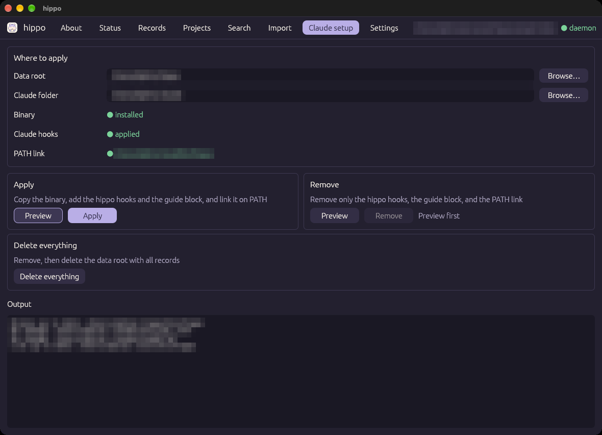
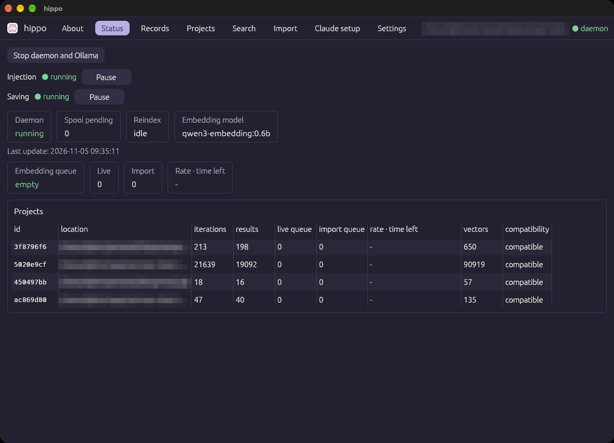

# Getting started

[← README](../../README.md) · [한국어](../ko/getting-started.md)

This document shows how to install the `hippo` app and apply it to Claude Code. For how to use the app window, see [Using the app](usage.md).

## Contents

1. [Requirements](#1-requirements)
2. [Prepare Ollama and the embedding model](#2-prepare-ollama-and-the-embedding-model)
3. [Get the app](#3-get-the-app)
4. [Apply it to Claude](#4-apply-it-to-claude)
5. [Check that it works](#5-check-that-it-works)
6. [Update](#6-update)
7. [Remove](#7-remove)

---

## 1. Requirements

| Item | Version used | Notes |
|------|--------------|-------|
| macOS | Darwin (Apple Silicon) | Only macOS is supported for now. Uses Unix sockets and launchd |
| Ollama | 0.40 or later | Runs the embedding model locally |
| Embedding model | `qwen3-embedding:0.6b` | The default. Supports Korean, English, and code. 32K context |
| Claude Code | 2.1.316 | The hook input and transcript format were checked on this version |

You need Rust (1.95 or later) and `protoc` (libprotoc 36 or later) only to build the app yourself. See [Development and contributing](development.md).

## 2. Prepare Ollama and the embedding model

```bash
brew install ollama
ollama serve &                      # needed only to pull the model the first time
ollama pull qwen3-embedding:0.6b
```

- `hippo` does not download the model for you. Pull it once with the commands above.
- You do not need to keep the Ollama server running. If `hippo` cannot reach the server, it starts `ollama serve` itself (`[embedder] autostart = true`). To run it as a service, use `brew services start ollama`.
- By default Ollama accepts requests only on `127.0.0.1:11434`. `hippo` refuses an embedder address that is not localhost.

## 3. Get the app

### Option A: download a release

From [Releases](https://github.com/Biisairo/Hippocampal-Index/releases), download `hippo-<version>-macos-arm64.zip` and unzip it.

The app is not signed or notarized with an Apple developer ID. So macOS blocks a downloaded copy. Before you open it the first time, remove the quarantine attribute:

```bash
xattr -dr com.apple.quarantine hippo.app
open hippo.app                      # you can move it to /Applications if you like
```

> **Caution:** If you open it with "Open Anyway" in System Settings instead, the copy that installation makes at `~/.hippo/bin/hippo` also keeps the quarantine attribute. Then the hooks may be blocked.

### Option B: build it yourself

```bash
git clone https://github.com/Biisairo/Hippocampal-Index.git hippo && cd hippo
brew install protobuf
scripts/bundle-app.sh               # makes target/hippo.app; the first build takes a few minutes
open target/hippo.app
```

Opening the app does not install anything. You install it from the app window in the next step.

## 4. Apply it to Claude

If `hippo` is not installed yet, the window opens the **Claude setup** tab and shows a notice at the top. Until you finish, only the **Claude setup** and **About** tabs are available.



1. Under **Where to apply**, check the two paths.
   - **Data root**: the folder that stores memory and settings. The default is `~/.hippo`.
   - **Claude folder**: the Claude Code settings folder that gets the hooks. The default is `~/.claude`. To apply it to one project only, choose that project's `.claude` folder.
   - Use **Browse…** next to a field to choose a folder. Hidden folders are shown.
2. In the **Apply** card, press **Preview**. The changes (a diff) appear under **Output**. Nothing is written at this step.
3. Check the changes, press **Apply**, and confirm once more. **Apply** is available only after a preview with the same inputs.
4. When Binary, Claude hooks, and PATH link all turn green, you are done.
5. **Start a new Claude Code session.** A session that was already open is recorded from the turn that the hook reports.

**Apply** makes these changes:

| Target | Change |
|--------|--------|
| `<data root>/bin/hippo` | Copies the app's binary. The hooks and the daemon use this copy, so they keep working if you move or delete the app |
| `<Claude folder>/settings.json` | Merges the `hippo` hook entries. Other hooks and settings stay. Before writing, it backs up the original to `<file>.hippo-backup-<unix time>` |
| `<Claude folder>/CLAUDE.md` | Adds an English guide block that tells Claude it can use `hippo search` and `hippo show`. Text outside the block stays |
| `~/.local/bin/hippo` | Makes a link to the installed binary. If `~/.local/bin` is on your PATH, you can run `hippo` in a terminal |

For the detailed rules (symbolic links, broken JSON, backups), see [`install` in the CLI reference](cli.md#install).

## 5. Check that it works

The **Status** tab shows the daemon, the embedding model, and the record counts per project.



- You do not need to start the daemon. The hooks or the app start it when needed, and it stops by itself after 30 minutes without requests.
- Have a few exchanges in Claude Code. If **iterations** goes up, records are being saved.
- When the **Embedding queue** reaches 0, all records are searchable.

To use conversations from before you installed `hippo`, bring them in with the [Import tab](usage.md#import-tab).

## 6. Update

Download and open the new app, then press **Preview** and **Apply** again in the **Claude setup** tab.

- If the installed binary differs from the app, the window shows "update needed".
- When the binary changes, the old daemon stops. The next request starts the daemon with the new binary.
- Files with the same content are not written again ("No change").

## 7. Remove

In the **Claude setup** tab, choose one of two buttons.

| Button | Deletes | Keeps |
|--------|---------|-------|
| **Remove** | The hook entries, the guide block, the `~/.local/bin/hippo` link | The binary and all records |
| **Delete everything** | Everything Remove deletes, then the whole data root | Nothing. All stored memory is deleted and cannot be recovered |

- Like **Apply**, **Remove** is available only after a preview.
- **Delete everything** shows the path it will delete and asks for confirmation. It stops the daemon and any Ollama server that `hippo` started, then deletes. It does not delete while the daemon is reindexing.
- Move the app to the Trash.
- If you registered the daemon with launchd yourself, unregister it first:

  ```bash
  launchctl bootout gui/$(id -u)/com.hippo.daemon
  rm ~/Library/LaunchAgents/com.hippo.daemon.plist
  ```
