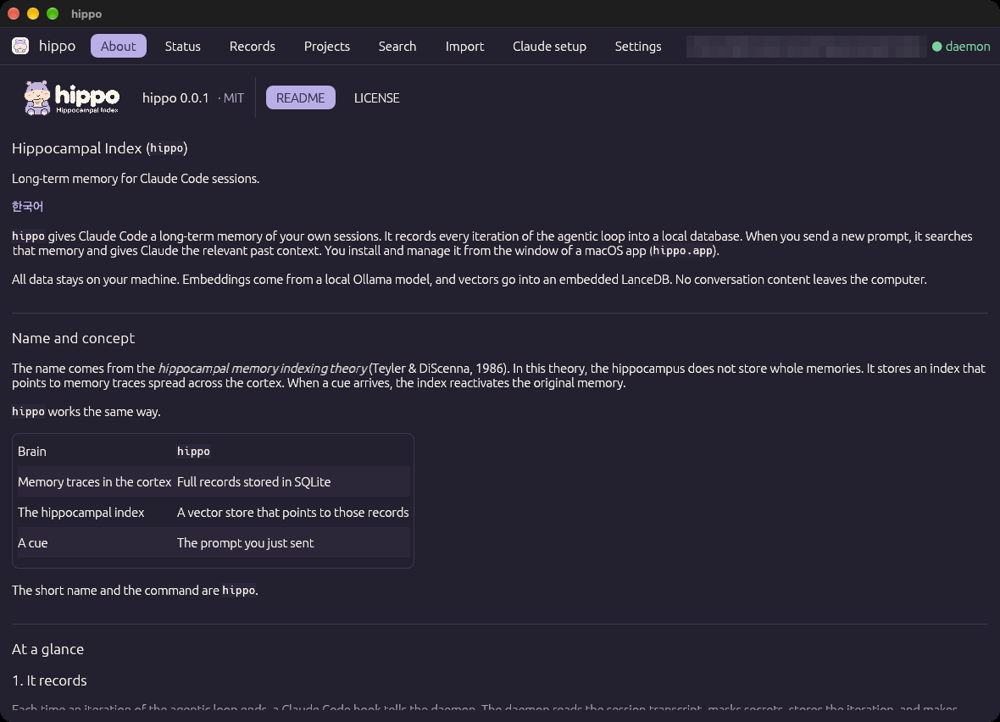
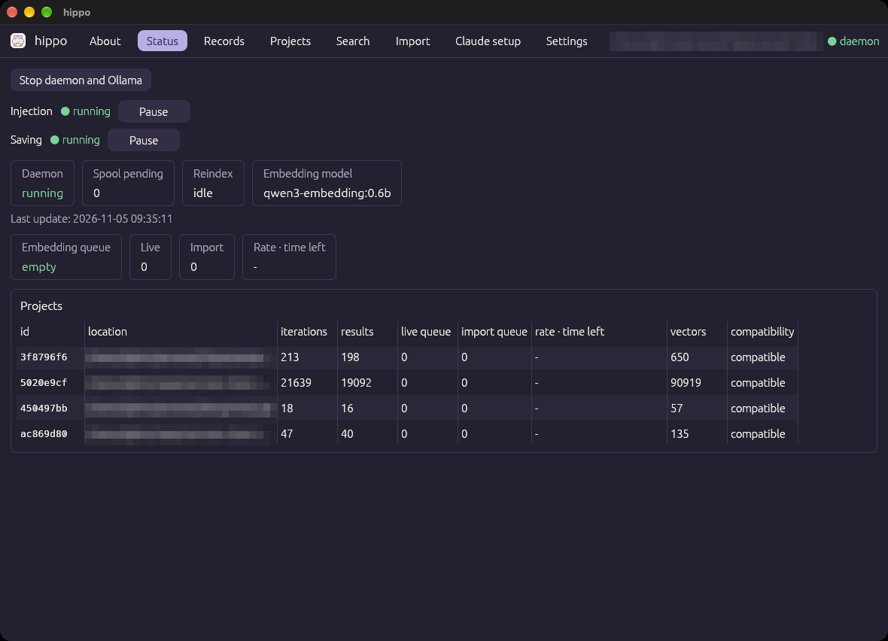
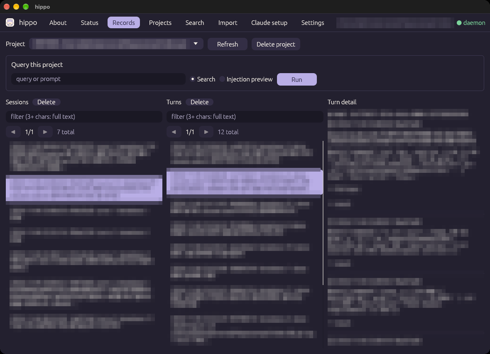
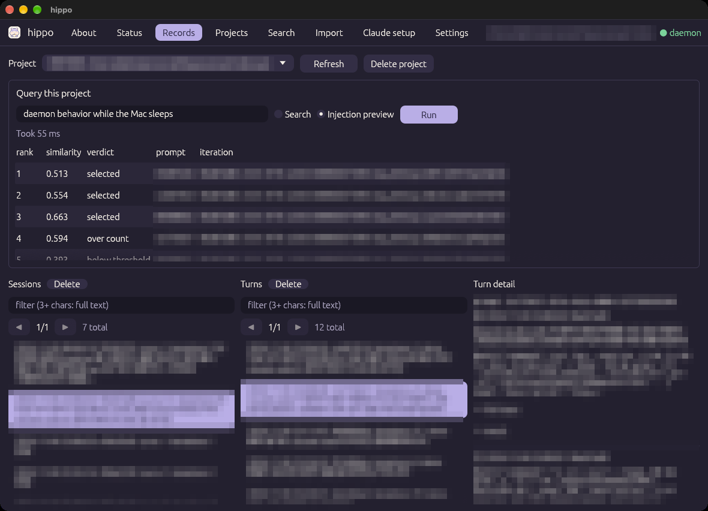
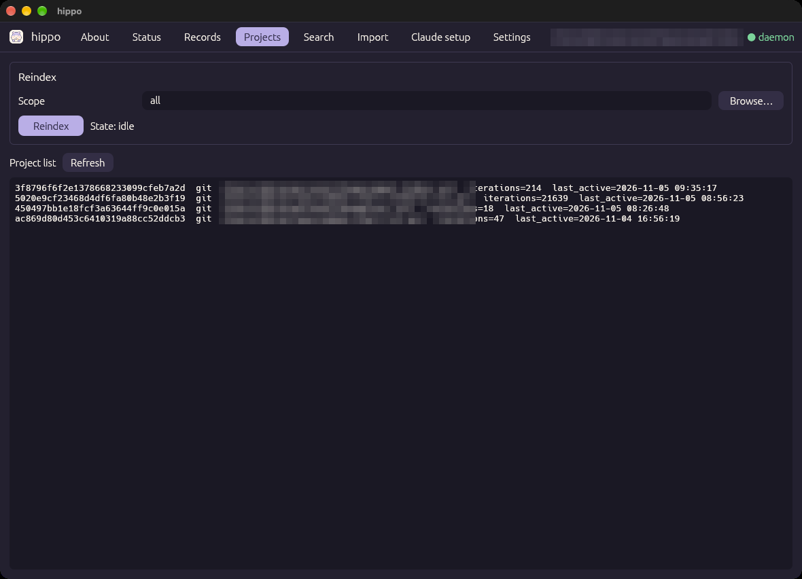
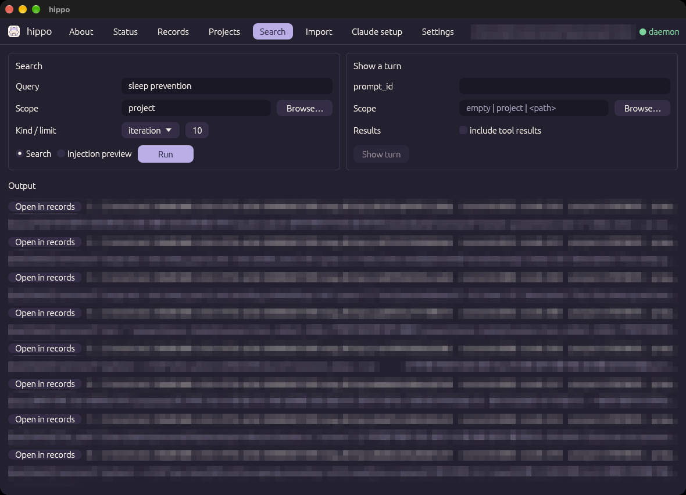
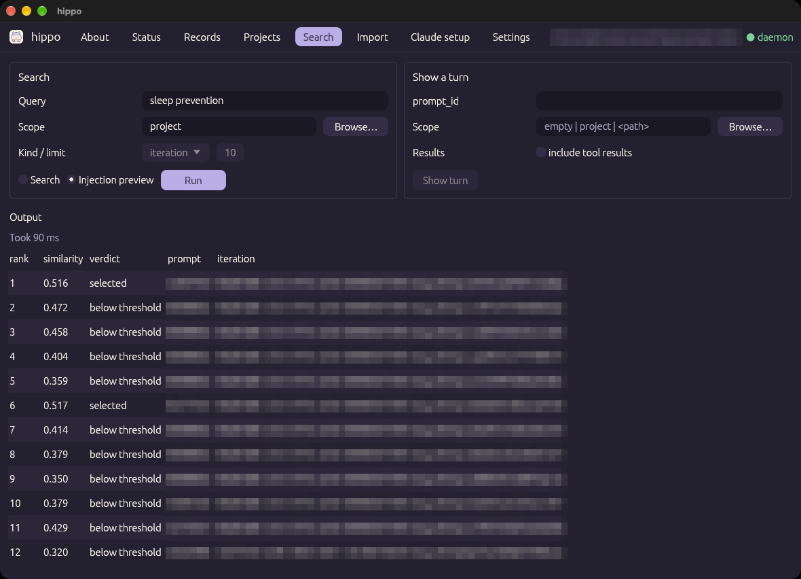
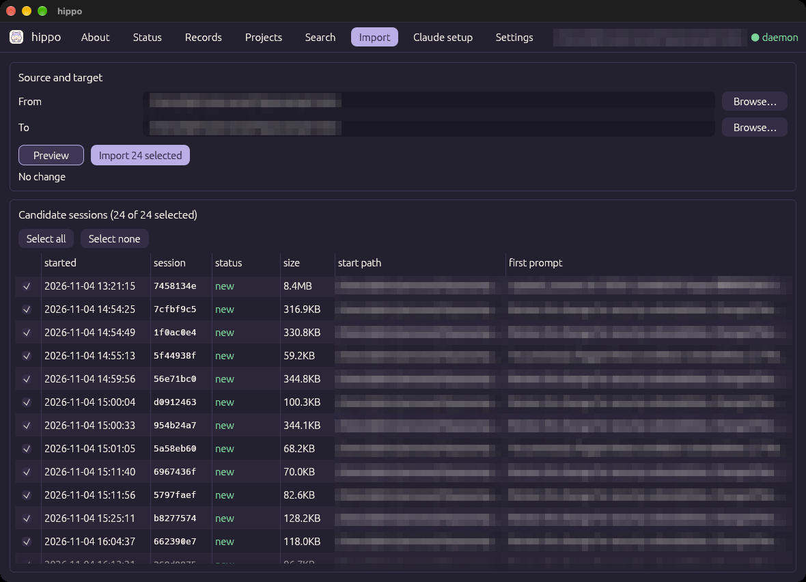
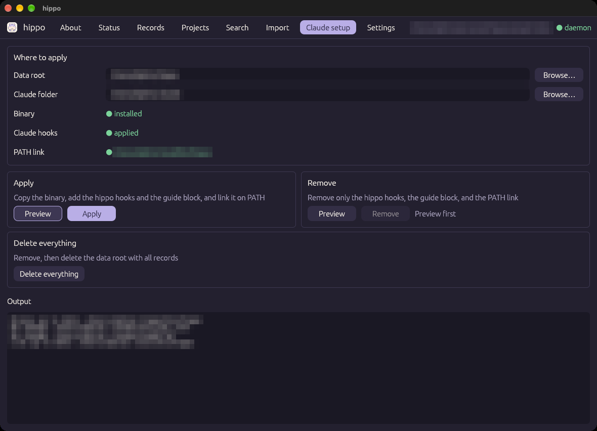
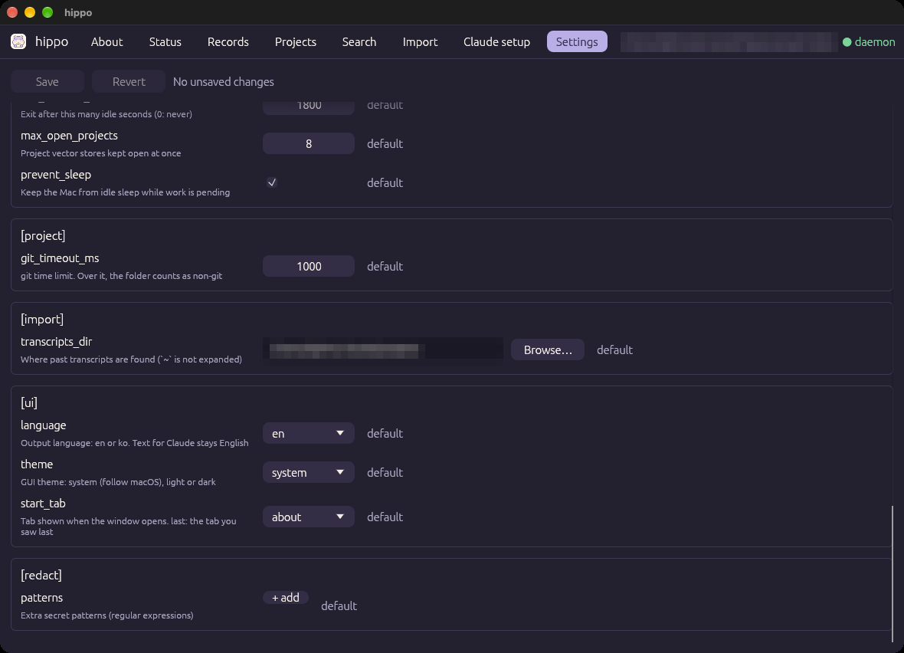

# Using the app

[← README](../../README.md) · [한국어](../ko/usage.md)

After installation, capture and automatic injection work on their own. You use the app window to browse records, search, import past conversations, and change settings. For installation, see [Getting started](getting-started.md).

> In the screenshots, conversation content, project names, and paths are blurred.

## Contents

- [Window layout](#window-layout)
- [About tab](#about-tab)
- [Status tab](#status-tab)
- [Records tab](#records-tab)
- [Projects tab](#projects-tab)
- [Search tab](#search-tab)
- [Import tab](#import-tab)
- [Claude setup tab](#claude-setup-tab)
- [Settings tab](#settings-tab)
- [Deleting records](#deleting-records)
- [How Claude uses memory](#how-claude-uses-memory)

---

## Window layout

- **Open the app**: open `hippo.app`. In a terminal, `hippo gui` opens the same window. It is a native window (egui). It does not use a browser or a web view.
- **Tabs at the top**: About, Status, Records, Projects, Search, Import, Claude setup, Settings.
- **First tab**: the default is the **About** tab. You can change it to another tab or to `last` (the tab you saw last) with `[ui] start_tab` in the [Settings tab](#settings-tab).
- **Top right**: the current folder and the daemon connection. The current folder is the base folder of every request and the default of path fields. It is `/` for an app opened from Finder, and the folder where you ran the command for `hippo gui`.
- **Browse…**: next to each path field. It opens the macOS folder picker. Hidden folders such as `~/.claude` are shown.
- **Language and theme**: the window text follows `[ui] language` (`en` or `ko`). Colors follow the macOS light or dark mode by default, and `[ui] theme` can fix one. Both apply as soon as you change them in the [Settings tab](#settings-tab).
- **Data root**: the window uses the data root of the installed binary. For a binary that is not installed, such as the one inside the app, it uses the root that the `~/.local/bin/hippo` link points to, or `~/.hippo` if there is no link. If that root has no binary or a different one, the window shows a notice at the top and keeps only the **Claude setup** and **About** tabs available.

---

## About tab

Shows the version, the README, and the LICENSE.

- The README is shown with Markdown formatting such as headings, tables, and code blocks. Images are not shown.
- Clicking a document link in the README opens that document on GitHub in your default browser.

---

## Status tab

Shows the daemon and embedding progress, refreshed every 2 seconds.

| Area | Contents |
|------|----------|
| **Stop daemon and Ollama** | Stops the daemon and any Ollama server that `hippo` started, now. After that, polling also stops and waits until you press **Start again** |
| **Injection / Saving** | **Pause** or **Resume** automatic injection and record saving separately. See [Pausing](#pausing) below |
| Daemon, Spool pending, Reindex, Embedding model | Daemon state, requests queued while the daemon was down, reindex state, the embedding model in use |
| **Embedding queue** | Pending embeddings in all projects, split into live and import work. If work was done in the last 5 minutes, the rate and time left are shown too |
| **Projects** table | Per project: iteration and result counts, live and import queues, rate and time left, vector count, compatibility (`empty`, `compatible`, `mismatch`) |

While the window is open, the daemon does not stop for being idle.

### Pausing

- **Pause injection**: from the next prompt, no past memory is injected. Records are still saved.
- **Pause saving**: new records are not saved. When you press **Resume**, open sessions also save what happened during the pause at the next capture.
- The two buttons change `[inject] enabled` and `[capture] enabled` in `config.toml`. The hooks read the settings every time, so you do not need to restart the daemon.

---

## Records tab

Browse the records of one project in the order **session → turn → turn detail**.

1. Choose a project in **Project** at the top. At first, the project of the current folder is selected.
2. Choose a session in the **Sessions** list (newest first).
3. Choose a turn in the **Turns** list (oldest first). Each turn shows its embedding state as `done` or `pending n`.
4. **Turn detail** shows the iterations of that turn in order: input, tool calls, and response. Long tool input (**full input**) and tool output (**result**) are folded.

- Lists show 50 items per page. Use ◀ ▶ to move.
- Type in a **filter** above a list to keep only the sessions and turns that have an iteration containing the text. Three or more characters use full-text search. Shorter text uses a plain substring match.
- **Refresh** reloads the lists.

### Query this project

The query field above the lists does two things.

- **Search**: hybrid search in this project. Click a result to open that turn.
- **Injection preview**: works out what would be injected if you sent the text as a prompt.

The injection preview uses the same settings and rules as automatic injection. But it does not exclude the current session, and it has no time budget.

- Each candidate shows its RRF rank, similarity, and verdict. The verdict is one of `selected`, `below threshold`, `FTS only`, `same turn`, `over length limit`, `over count`.
- It also shows the **Injected text** and the time taken. If nothing is injected, it shows why.
- If too much or too little is injected, adjust `[inject] threshold` in [Configuration](configuration.md) while you watch this screen.

---

## Projects tab

Lists projects and rebuilds vector indexes.

- **Project list**: project id, kind (`git`/`dir`), location, iteration count, last activity time.
- **Reindex**: rebuilds the vector index for the scope (`all`, `project`, or a path). Use it when the compatibility becomes `mismatch` after you change the embedding model or dimension. Search keeps working on the old index during reindexing. See [changing the embedding model](configuration.md#changing-the-embedding-model-or-vector-db).

---

## Search tab

Search any scope, preview injection, or show one whole turn. This is the same as `hippo search` and `hippo show` in the CLI.

The **Search** card:

| Field | Value |
|-------|-------|
| Query | What to find |
| Scope | `project` (the project of the current folder), `all` (every project), or a path |
| Kind / limit | `iteration`, `result` (tool output), `both` / number of results (default 10) |

Choose **Search** or **Injection preview**, then press **Run**.

- **Search**: each result shows the RRF score, vector similarity (`sim=-` means a keyword-only match), project id, `prompt_id`, and a preview. **Open in records** on an iteration result opens that project and turn in the [Records tab](#records-tab).
- **Injection preview**: shows what would be injected if you sent the query as a prompt. The result looks the same as the [injection preview in the Records tab](#query-this-project). Automatic injection works inside one project, so the scope must be `project` or a path. If the scope is `all` or empty, **Run** is disabled and the reason is shown. Kind and limit are not used.

The **Show a turn** card shows one turn by `prompt_id`. With an empty scope, it looks in the current project first, then in the other projects, most recently used first. Turn on **include tool results** to show the raw tool output too.

---

## Import tab

Brings in conversations from before you installed `hippo`, or from before you moved a folder. It reads the past transcripts that Claude Code keeps (`~/.claude/projects/*/*.jsonl`).

1. **From**: the folder where the conversations took place. It does not need to exist now. For a git repository, sessions opened in its worktrees are included.
2. **To**: the folder of the project that receives the records. Usually the same as From. If you moved a folder, put the old path in From and the new path in To.
3. Press **Preview**. It changes nothing. It shows what will happen (create a project, move a location, merge) and the **Candidate sessions** table.
4. Choose the sessions to import in the table. Sessions that are `new` or `live-only` are selected at first.
5. Press **Import N selected**. **Stop** stops after the session in progress.

The **status** column of the candidate table is one of these:

| Status | Meaning |
|--------|---------|
| `new` | A session not stored yet |
| `live-only` | Stored only from when live capture started. The earlier part is filled in |
| `imported` | Already fully imported |
| `other project` | Pinned to another project. Skipped |

- The first prompt is shown with secrets masked, and only its start.
- You can follow the embedding progress of imported records in the **Import** queue of the [Status tab](#status-tab). The daemon handles live work before import work, so new conversations are still saved and searchable on time during an import.
- You can stop at any time. Importing again skips finished sessions and continues with the rest.

For the detailed rules (merging, fork copies, held-back iterations), see [`import` in the CLI reference](cli.md#import).

---

## Claude setup tab

Applies `hippo` to Claude Code or removes it, and deletes all data.

- **Where to apply**: choose the data root and the Claude folder, and see the state of the binary, Claude hooks, and the PATH link.
- **Apply / Remove**: check the changes with **Preview** first. **Apply** or **Remove** is available only after a preview with the same inputs, and asks for confirmation once more.
- **Delete everything**: removes, then deletes the data root and all records. This cannot be undone.

For the steps and the files each button changes, see [Getting started](getting-started.md#4-apply-it-to-claude).

---

## Settings tab

Shows every key in `config.toml` with a description and whether it is the default.

- Edit values, then press **Save**. **Revert** discards unsaved changes.
- **↺ default** next to a key returns it to the default, and saving removes that key from the file.
- Saving changes only the keys you edited and keeps comments you wrote in the file. The result is checked before saving, and an invalid configuration is not written.
- If a change needs a daemon restart, a **Restart daemon** button appears. If it needs a reindex, that is shown too.
- `[ui] language` and `[ui] theme` change as soon as you save. `[ui] start_tab` applies the next time you open the window.

What each key means is in [Configuration](configuration.md).

---

## Deleting records

You can delete from the [Records tab](#records-tab).

| Button | What it deletes |
|--------|-----------------|
| **Delete** next to **Sessions** | The selected session |
| **Delete** next to **Turns** | The selected turn: every iteration with that `prompt_id` in all sessions of the project |
| **Delete project** | The whole project |

Each button first shows what will be deleted (project id and location, and the session, turn, iteration, and result counts) and asks for confirmation.

- Deleted records are not kept anywhere and cannot be recovered.
- A tool output is deleted only when no remaining record refers to it. Several sessions can share the same output.
- Deleting a session also deletes how far that session was read. If the session is still open, it is saved again from the next hook. A past session comes back if you import it again.
- After you delete a project, a new session in the same folder starts a new project.
- Nothing is deleted during a reindex. If an embedding batch is in progress, deletion waits until the batch ends. A batch with many long tool outputs can take tens of seconds.

---

## How Claude uses memory

- **Automatic injection**: on every prompt, the few best-matching turns from other sessions of the same project are given to Claude. The injection rules are in [Architecture](architecture.md#4-how-memory-is-used).
- **Claude searches by itself**: automatic injection gives only a few turns. When more is needed, Claude runs `hippo search` and `hippo show` itself. **Apply** adds a guide block about this to `CLAUDE.md`, so you do not need to write it.
- **Ask directly**: ask Claude something like "find how we fixed the token expiry bug last time", and Claude looks it up with those commands.
