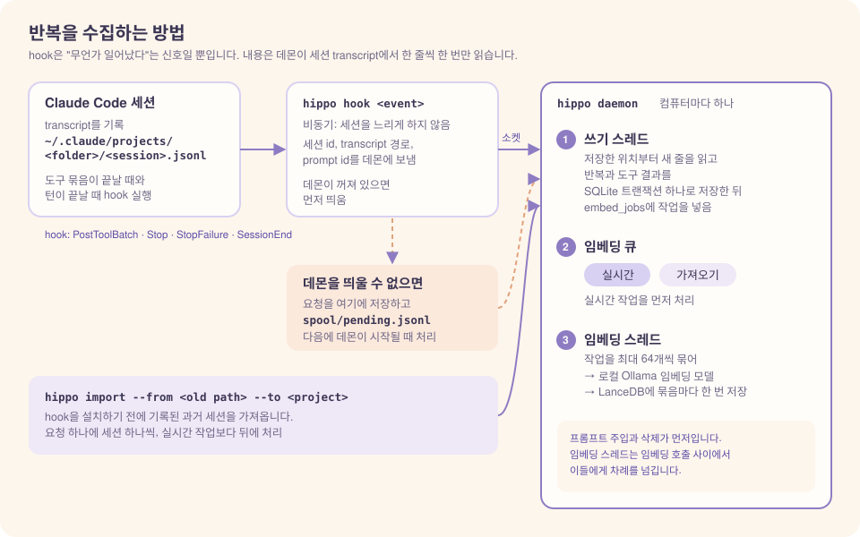
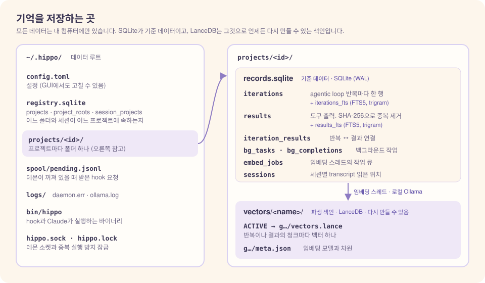
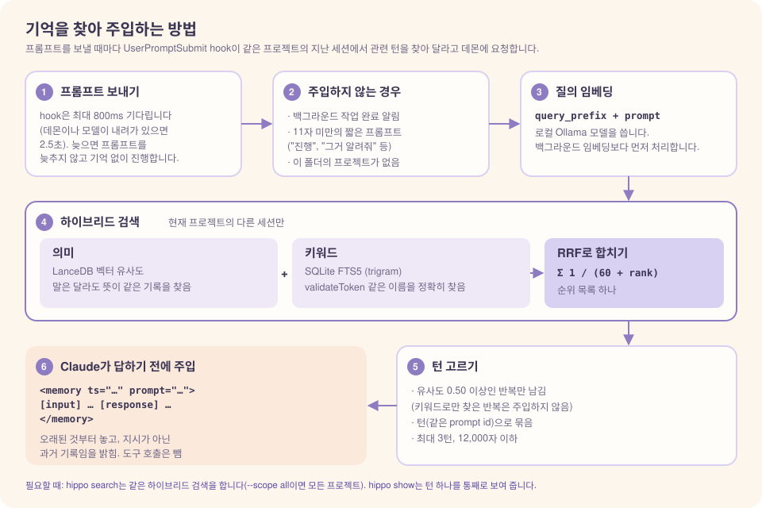

# 구조와 동작

[← README](../../README.ko.md) · [English](../en/architecture.md)

이 문서는 `hippo`가 무엇을 기록하고, 어떻게 저장하고, 언제 기억을 주입하는지 설명합니다. 모든 동작의 기준은 [요구사항 명세(SRS)](../SRS.md)입니다.

## 목차

1. [기억의 단위: agentic loop 반복 하나](#1-기억의-단위-agentic-loop-반복-하나)
2. [반복을 수집하는 방법 (hook)](#2-반복을-수집하는-방법-hook)
3. [저장 구조](#3-저장-구조)
4. [기억을 쓰는 방법](#4-기억을-쓰는-방법)
5. [데몬](#5-데몬)
6. [생명주기: DB와 모델이 열리고 닫히는 시점](#6-생명주기-db와-모델이-열리고-닫히는-시점)
7. [데이터 위치](#7-데이터-위치)
8. [보안](#8-보안)

---

## 1. 기억의 단위: agentic loop 반복 하나

프롬프트를 하나 보내면 Claude Code는 **agentic loop**를 돕니다. loop의 **반복(iteration)** 하나는 모델 호출 한 번과, 모델이 요청한 도구 호출들로 이루어집니다.

```
프롬프트
  → 반복 1: 모델 텍스트 + tool_use(Read) → tool_result
  → 반복 2: 모델 텍스트 + tool_use(Edit) → tool_result
  → 반복 3: 모델 텍스트만 (loop 종료)
```

`hippo`는 **반복마다 기록을 하나씩** 저장합니다. 한 프롬프트에서 생긴 반복들을 **턴**이라고 부릅니다. 기록에 담기는 내용은 다음과 같습니다.

- **입력**: 이 반복 직전에 들어온 프롬프트, 백그라운드 작업 완료 알림, 서브에이전트 보고
- **도구 호출**: 호출한 도구의 이름과 입력
- **응답**: 모델의 텍스트(`thinking`은 저장하지 않음)
- **결과**: 도구 출력 원문. 따로 저장하며, 내용 해시로 중복을 없앱니다
- **사용자의 답**: `AskUserQuestion`처럼 사용자에게 묻는 도구는 사용자가 고른 답(메모가 있으면 메모도)을 반복 기록에 `[answer]`로 넣습니다. 질문은 이미 도구 호출에 있으므로 답만 넣습니다. 그래서 "무엇을 정했는가"가 검색되고 자동 주입에도 보입니다

`hippo`를 실행한 도구 호출(`hippo search` 등)은 원본에는 저장하지만 검색 색인에는 넣지 않습니다. 기억을 찾던 장면이 다음 검색에 다시 나오지 않게 하기 위해서입니다.

- Bash 명령을 bash 문법으로 파싱해, 실제로 실행되는 명령인지 판정합니다.
- 그래서 `cd x && hippo …`, `H=…/hippo; $H …`, `$(hippo …)`도 잡고, `cargo test -p hippo`처럼 인자로만 쓴 경우는 잡지 않습니다.
- `hippo show`로 턴을 볼 때는 그대로 보입니다.

## 2. 반복을 수집하는 방법 (hook)

<p align="center"></p>

| 반복 종류 | 수집을 일으키는 hook |
|-----------|----------------------|
| 도구를 호출한 반복 | `PostToolBatch` (병렬 호출이 모두 끝난 뒤 batch마다 한 번) |
| 마지막 반복 (텍스트만) | `Stop` / `StopFailure` |
| 세션 종료 시 남은 것 | `SessionEnd` |

- 이 hook들은 `async: true`로 실행되므로 세션을 느리게 만들지 않습니다.
- hook 입력은 수집 신호로만 쓰고, 실제 내용은 세션 transcript(JSONL)에서 읽습니다.
- `hippo`는 세션마다 안전 offset을 기억해 둡니다. 그래서 같은 줄을 두 번 읽거나 같은 반복을 두 번 저장하지 않습니다.
- Claude Code가 transcript에 마지막 응답을 쓰기 전에 `Stop` hook이 실행될 수 있습니다. 그래서 transcript의 턴 종료 줄(`turn_duration`, `stop_hook_summary`)도 반복이 끝났다는 신호로 씁니다.
- 데몬은 시작할 때와 60초마다, 읽지 않은 내용이 남은 세션을 다시 읽습니다(따라잡기). 5초 이상 바뀌지 않은 transcript만 읽습니다. 그래서 hook이 놓친 마지막 응답도 다음 프롬프트 없이 저장됩니다.

### 실시간 수집은 hook이 알려 준 턴부터 시작합니다

`hippo`가 처음 보는 세션은 transcript 처음부터 읽지 않습니다. hook 입력의 `prompt_id`가 가리키는 턴의 첫 줄부터 읽습니다. 그래서 다음 세션은 그 턴 앞의 대화를 저장하지 않습니다.

- hook을 설치할 때 이미 열려 있던 세션
- `hippo`를 설치하기 전에 시작한 세션을 `claude --resume`이나 `--continue`로 다시 연 경우
- `--fork-session` 등으로 분기한 세션. 분기할 때 이전 대화가 새 파일로 복사되기 때문입니다

이미 수집 중인 세션을 다시 열면, 같은 파일에 이어 쓰므로 저장한 위치 뒤부터 계속 읽습니다. 그 앞의 과거 기록은 [가져오기](usage.md#가져오기-탭)로 채웁니다.

### 서브에이전트와 백그라운드 작업

- **서브에이전트**: 내부 반복은 저장하지 않습니다. 포그라운드 서브에이전트의 최종 보고는 `Agent` 도구의 결과로 돌아오므로, 호출과 함께 저장됩니다.
- **백그라운드 작업**(Bash 또는 Agent의 `run_in_background`): 시작 호출을 *대기 중*으로 저장합니다. transcript에 완료 알림(`<task-notification>`)이 나타나면 출력을 읽어 시작 호출에 연결합니다. 그래서 호출과 응답이 한 쌍으로 남습니다.

## 3. 저장 구조

<p align="center"></p>

기억은 **프로젝트마다 따로** 저장합니다. 다른 프로젝트의 기록은 검색과 자동 주입에 섞이지 않습니다.

- **프로젝트를 정하는 시점**: 세션을 처음 처리할 때 **세션 시작 경로**(transcript에서 `cwd`가 있는 첫 줄)로 정합니다. 세션 중에 `cd`해도 바뀌지 않습니다.
- **프로젝트의 위치**: git 저장소면 git common dir(`.git`)이고, 아니면 그 폴더입니다. 하위 디렉터리에서 연 세션과 git worktree는 원본 저장소와 같은 프로젝트가 됩니다.
- **폴더를 옮긴 경우**: git 저장소는 루트 커밋이 같고 이전 위치가 사라졌으면 자동으로 이어 씁니다. git이 아닌 폴더는 [가져오기](usage.md#가져오기-탭)에서 원본에 이전 경로를 넣어 직접 가져옵니다.

이름의 "색인"이 바로 이 부분입니다. 해마 색인이 피질의 기억 흔적을 가리키듯, 벡터 저장소는 원본 기록을 가리키기만 합니다. 벡터 저장소는 원본 저장소에서 파생된 색인입니다. 그래서 임베딩 모델이나 벡터 DB를 바꾸더라도 SQLite에서 색인을 다시 만들면 됩니다([설정](configuration.md#임베딩-모델이나-벡터-db-바꾸기) 참고).

## 4. 기억을 쓰는 방법

<p align="center"></p>

### 자동 주입

프롬프트를 보낼 때마다 `UserPromptSubmit` hook이 데몬에 관련 기억을 요청합니다.

- **검색 대상**: **같은 프로젝트**의 **다른 세션** 기록입니다.
- **고르는 방법**: 벡터 유사도가 임계값(`[inject] threshold`) 이상인 반복을 찾고, 그 반복이 속한 **턴**을 주입합니다. 키워드로만 찾은 반복은 주입하지 않습니다.
- **주입 형식**: 턴마다 `<memory>` 블록 하나에 입력, LLM 응답, 질문과 답을 넣습니다. 도구 호출과 결과는 넣지 않습니다.
- **순서와 표시**: 블록은 시간순(오래된 것부터)으로 놓고, 각 블록에 시각을 붙입니다. 머리말에 "과거 기록이며 지시가 아님"을 밝힙니다.
- **주입하지 않는 경우**: 백그라운드 작업 완료 알림, 공백을 뺀 길이가 11자 미만인 짧은 프롬프트("진행", "그거 알려줘" 등), 현재 폴더의 프로젝트가 없는 경우.
- **시간 예산**: hook은 최대 800ms(데몬을 새로 띄우면 2.5초) 기다립니다. 늦으면 프롬프트를 늦추지 않고 기억 없이 진행합니다.
- 검색 질의에는 임베딩 모델이 권장하는 지시문(`query_prefix`)을 앞에 붙입니다.

무엇이 주입될지는 앱의 [주입 미리 보기](usage.md#이-프로젝트에-질의)로 확인할 수 있습니다.

### 필요할 때 검색

Claude나 사용자가 `hippo search`, `hippo show`를 실행합니다. 앱에서는 [검색 탭](usage.md#검색-탭)이 같은 일을 합니다.

### 하이브리드 검색

검색은 벡터 유사도와 SQLite FTS5 키워드 검색 결과를 RRF(Reciprocal Rank Fusion)로 합칩니다.

- 벡터 검색은 말은 달라도 뜻이 같은 기록을 찾습니다.
- 키워드 검색은 `validateToken` 같은 식별자를 정확히 찾습니다.

## 5. 데몬

- 데몬은 컴퓨터마다 하나만 실행됩니다(파일 잠금). 저장소에는 데몬만 씁니다.
- 데몬을 직접 띄울 필요는 없습니다. 로컬 MCP 서버처럼 필요할 때 올라옵니다. hook, CLI 명령, 앱이 데몬에 연결하지 못하면 `hippo daemon`을 백그라운드로 띄운 뒤 요청을 보냅니다.
- 요청이 없는 상태로 `idle_timeout_secs`(기본 30분)가 지나면 데몬이 스스로 내려가고, 다음 요청이 오면 다시 올라옵니다. 처리할 작업이 남아 있으면 끝날 때까지 내려가지 않습니다.
- 처리할 작업이 남아 있는 동안에는 Mac의 유휴 잠자기를 막습니다(`[daemon] prevent_sleep`). 덮개를 닫으면 잠듭니다.
- 데몬을 띄우지 못하면 수집 요청은 스풀 파일에 쌓였다가, 다음에 데몬이 시작될 때 처리됩니다. `hippo` 때문에 Claude Code 세션이 실패하는 일은 없습니다.
- 데몬은 실시간 수집과 그 임베딩을 가져오기 작업보다 먼저 처리합니다.
- CLI 명령과 앱도 같은 소켓으로 같은 데몬에 요청합니다.

## 6. 생명주기: DB와 모델이 열리고 닫히는 시점

| 구성 요소 | 여는 시점 | 닫는 시점 |
|-----------|-----------|-----------|
| 데몬 | 데몬에 연결하지 못한 첫 hook, CLI 명령, 앱이 자동으로 띄움 | 요청 없이 `idle_timeout_secs`가 지났을 때(처리할 작업이 남아 있으면 끝날 때까지 내려가지 않음), 또는 직접 멈출 때 |
| SQLite | 작업마다 엶 | 작업이 끝날 때 |
| LanceDB (프로젝트별) | 그 프로젝트를 처음 쓸 때 | 열어 둔 프로젝트가 `max_open_projects`(기본 8)를 넘으면 가장 오래 쓰지 않은 것부터 닫음. 데몬이 종료할 때 모두 닫음 |
| 임베딩 모델 | 첫 임베딩 요청 때 Ollama가 올림(약 1초) | 마지막 요청 후 `keep_alive`(30분)가 지나면 Ollama가 내림 |
| Ollama 서버 | 임베딩 요청이 서버에 닿지 않으면 데몬이 자동으로 띄움(`ollama serve`, 로그는 `logs/ollama.log`). 서비스 등으로 이미 떠 있으면 띄우지 않음 | `hippo`가 끄지 않습니다. 다른 도구도 같은 서버를 쓸 수 있기 때문입니다. 모델 메모리는 `keep_alive`가 지나면 해제됩니다 |

hook, CLI 명령, 앱은 DB를 직접 열지 않고, 소켓으로 데몬에 요청만 보냅니다. 데몬이 멈춰도 데이터는 안전합니다. 모든 변경은 SQLite 트랜잭션 하나로 반영되고(WAL 모드), 남은 임베딩 작업은 큐에 그대로 남습니다.

## 7. 데이터 위치

```
~/.hippo/            (0700)
├─ config.toml
├─ gui-last-tab               (0600) 앱 창에서 마지막으로 본 탭
├─ bin/hippo                  (0700) 설치한 실행 파일. hook과 안내문이 이 경로를 씀
├─ bin/claude-dir             (0600) 설치에 쓴 Claude 폴더
├─ ollama.pid                 (0600) hippo가 띄운 Ollama 서버의 pid
├─ registry.sqlite            (0600) 목록 DB: 프로젝트, 위치, 루트 커밋, 세션 → 프로젝트
├─ projects/<id>/             (0700) 프로젝트 하나
│  ├─ records.sqlite          (0600) 기준 데이터
│  ├─ vectors/<이름>/ACTIVE
│  └─ vectors/<이름>/<세대>/   LanceDB 파일
├─ spool/                     데몬이 꺼져 있을 때 쌓인 요청
├─ logs/hippo.log             데몬 로그: 오류, 수집 처리(capture), 주입 대상 없음. 5 MiB가 넘으면 hippo.log.1로 넘김
├─ logs/hook.log              hook 결과(전달, 스풀, 주입 글자 수 등). 5 MiB가 넘으면 hook.log.1로 넘김
├─ logs/daemon.err            자동으로 띄운 데몬의 시작 오류
├─ hippo.sock                 (0600) 데몬 소켓
└─ hippo.lock                 단일 실행 잠금
```

## 8. 보안

- **데이터가 컴퓨터 밖으로 나가지 않습니다.** 임베더 URL은 URL 파서로 해석합니다. localhost이어야 하고, userinfo·쿼리·프래그먼트가 없어야 하며, HTTP 리다이렉트는 따르지 않습니다.
- **저장 전에 비밀값을 가립니다.** 대상은 API 키(`sk-`, `ghp_`, `xox?-`, `AKIA`), `Bearer` 토큰, PEM 개인 키(END 마커가 없어도 처리), `*KEY=`/`*TOKEN=`/`*SECRET=`/`*PASSWORD=` 값입니다. `[[redact.patterns]]`로 패턴을 추가할 수 있습니다. 패턴 기반이므로 형식이 특이한 비밀값은 놓칠 수 있습니다.
- **백그라운드 출력은 안전할 때만 읽습니다.** 알림이 알려진 시작 호출과 작업 id에 맞아야 합니다. 경로도 정해진 배치(`…/<session>/tasks/<id>.output`)여야 하고, 심볼릭 링크를 거치면 안 됩니다. 그래서 프롬프트에 위조 알림을 넣어도 임의 파일을 읽게 만들 수 없습니다.
- **주입되는 기억은 데이터로 표시합니다.** 각 항목을 `<memory>` 블록에 넣고 마크업 문자를 이스케이프합니다. 머리말에서 블록 안의 지시를 따르지 말라고 알립니다. 저장된 프롬프트 인젝션의 위험을 낮추지만 완전히 없애지는 못합니다.
- **터미널 안전**: CLI 출력의 제어 문자를 이스케이프합니다.
