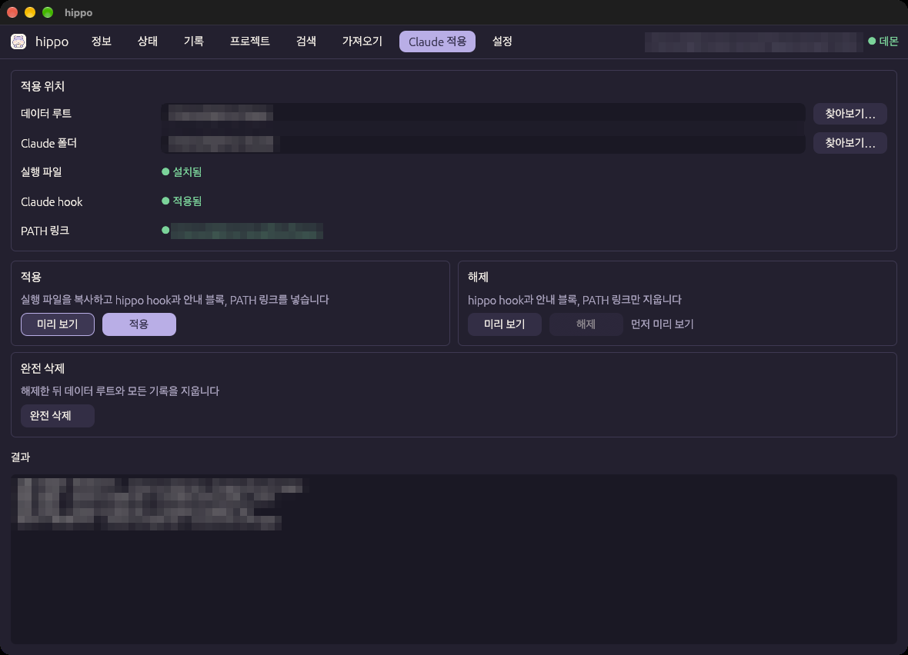
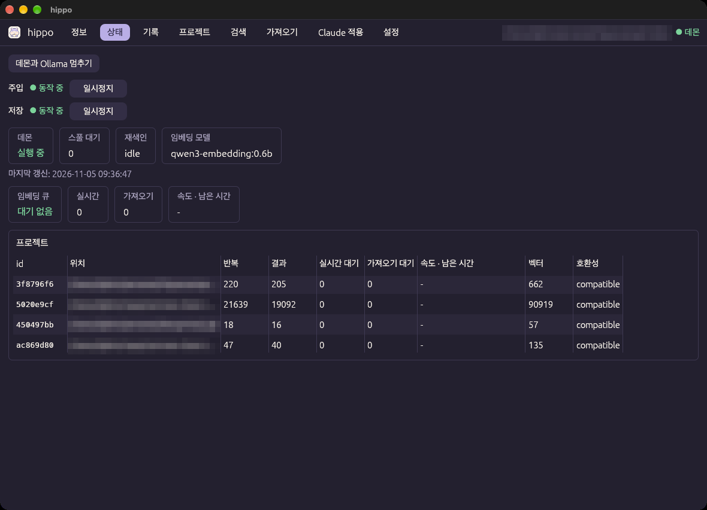

# 시작하기

[← README](../../README.ko.md) · [English](../en/getting-started.md)

이 문서는 `hippo` 앱을 설치하고 Claude Code에 적용하는 순서를 설명합니다. 앱 창의 사용법은 [GUI 사용법](usage.md)을 보십시오.

## 목차

1. [요구 사항](#1-요구-사항)
2. [Ollama와 임베딩 모델 준비](#2-ollama와-임베딩-모델-준비)
3. [앱 받기](#3-앱-받기)
4. [Claude에 적용하기](#4-claude에-적용하기)
5. [동작 확인](#5-동작-확인)
6. [업데이트](#6-업데이트)
7. [제거](#7-제거)

---

## 1. 요구 사항

| 항목 | 사용한 버전 | 비고 |
|------|-------------|------|
| macOS | Darwin (Apple Silicon) | 지금은 macOS만 지원합니다. Unix socket과 launchd를 씁니다 |
| Ollama | 0.40 이상 | 임베딩 모델을 로컬에서 실행합니다 |
| 임베딩 모델 | `qwen3-embedding:0.6b` | 기본값. 한국어, 영어, 코드를 지원하고 컨텍스트는 32K입니다 |
| Claude Code | 2.1.316 | 이 버전에서 hook 입력과 transcript 형식을 확인했습니다 |

앱을 직접 빌드할 때만 Rust(1.95 이상)와 `protoc`(libprotoc 36 이상)가 더 필요합니다. [개발과 기여](development.md)를 보십시오.

## 2. Ollama와 임베딩 모델 준비

```bash
brew install ollama
ollama serve &                      # 모델을 처음 받을 때만 필요합니다
ollama pull qwen3-embedding:0.6b
```

- 모델은 `hippo`가 대신 내려받지 않습니다. 위 명령으로 한 번 받아 두십시오.
- Ollama 서버를 계속 띄워 둘 필요는 없습니다. `hippo`가 서버에 연결하지 못하면 `ollama serve`를 직접 띄웁니다(`[embedder] autostart = true`). 서비스로 띄워 두고 싶으면 `brew services start ollama`를 씁니다.
- Ollama는 기본으로 `127.0.0.1:11434`에서만 요청을 받습니다. `hippo`는 localhost가 아닌 임베더 주소를 거부합니다.

## 3. 앱 받기

### 방법 A: 릴리스에서 받기

[Releases](https://github.com/Biisairo/Hippocampal-Index/releases)에서 `hippo-<버전>-macos-arm64.zip`을 받아 압축을 풉니다.

이 앱은 Apple 개발자 서명과 공증을 받지 않았습니다. 그래서 macOS가 내려받은 앱의 실행을 막습니다. 처음 열기 전에 격리 속성을 지웁니다.

```bash
xattr -dr com.apple.quarantine hippo.app
open hippo.app                      # 원하면 /Applications로 옮겨도 됩니다
```

> **주의:** 격리 속성을 지우지 않고 시스템 설정의 "그래도 열기"로 열면, 설치할 때 복사하는 `~/.hippo/bin/hippo`에도 격리 속성이 남습니다. 그러면 hook 실행이 막힐 수 있습니다.

### 방법 B: 직접 빌드하기

```bash
git clone https://github.com/Biisairo/Hippocampal-Index.git hippo && cd hippo
brew install protobuf
scripts/bundle-app.sh               # target/hippo.app을 만듭니다. 처음 빌드는 몇 분 걸립니다
open target/hippo.app
```

앱을 여는 것만으로는 아무것도 설치하지 않습니다. 설치는 다음 단계에서 앱 창으로 합니다.

## 4. Claude에 적용하기

아직 설치하지 않았으면 창은 **Claude 적용** 탭을 열고 위쪽에 안내를 띄웁니다. 설치를 마칠 때까지 **Claude 적용** 탭과 **정보** 탭만 쓸 수 있습니다.



1. **적용 위치**에서 두 경로를 확인합니다.
   - **데이터 루트**: 기억과 설정을 저장할 폴더입니다. 기본값은 `~/.hippo`입니다.
   - **Claude 폴더**: hook을 넣을 Claude Code 설정 폴더입니다. 기본값은 `~/.claude`입니다. 프로젝트 하나에만 적용하려면 그 프로젝트의 `.claude` 폴더를 고릅니다.
   - 입력란 옆의 **찾아보기…**로 폴더를 고를 수 있습니다. 숨김 폴더도 보입니다.
2. **적용** 카드의 **미리 보기**를 누릅니다. 바뀔 내용(diff)이 아래 **결과**에 나옵니다. 이 단계에서는 아무것도 쓰지 않습니다.
3. 내용을 확인한 뒤 **적용**을 누르고, 확인 창에서 한 번 더 확인합니다. **적용**은 같은 입력으로 미리 보기를 한 뒤에만 누를 수 있습니다.
4. 실행 파일, Claude hook, PATH 링크가 모두 초록색으로 바뀌면 끝입니다.
5. **Claude Code 세션을 새로 시작합니다.** 이미 열려 있던 세션은 hook이 알려 준 턴부터 저장합니다.

**적용**이 하는 일은 다음과 같습니다.

| 대상 | 변경 |
|------|------|
| `<데이터 루트>/bin/hippo` | 앱의 실행 파일을 복사합니다. hook과 데몬은 이 복사본을 씁니다. 그래서 앱을 옮기거나 지워도 계속 동작합니다 |
| `<Claude 폴더>/settings.json` | `hippo` hook 항목을 병합합니다. 다른 hook과 설정은 그대로 둡니다. 쓰기 전에 원본을 `<파일>.hippo-backup-<유닉스 시각>`으로 백업합니다 |
| `<Claude 폴더>/CLAUDE.md` | Claude가 `hippo search`와 `hippo show`를 쓸 수 있다는 영어 안내 블록을 넣습니다. 블록 밖의 내용은 그대로 둡니다 |
| `~/.local/bin/hippo` | 설치한 실행 파일을 가리키는 링크를 만듭니다. `~/.local/bin`이 PATH에 있으면 터미널에서 `hippo`를 바로 쓸 수 있습니다 |

세부 규칙(심볼릭 링크, 깨진 JSON, 백업 방식 등)은 [CLI 참고의 `install`](cli.md#install)에 있습니다.

## 5. 동작 확인

**상태** 탭에서 데몬, 임베딩 모델, 프로젝트별 기록 수를 봅니다.



- 데몬은 직접 띄울 필요가 없습니다. hook이나 앱이 필요할 때 띄우고, 요청이 없으면 30분 뒤 스스로 내려갑니다.
- Claude Code에서 대화를 몇 번 주고받은 뒤 **반복** 수가 늘어나면 기록이 잘 쌓이고 있는 것입니다.
- **임베딩 큐**가 0이 되면 모든 기록을 검색할 수 있습니다.

`hippo`를 설치하기 전의 과거 대화도 기억으로 쓰고 싶으면 [가져오기 탭](usage.md#가져오기-탭)으로 가져옵니다.

## 6. 업데이트

새 앱을 받아 연 뒤, **Claude 적용** 탭에서 **미리 보기**와 **적용**을 다시 누릅니다.

- 설치한 실행 파일이 앱과 다르면 창이 "업데이트 필요"를 보여 줍니다.
- 실행 파일이 바뀌면 이전 데몬을 내립니다. 다음 요청이 새 실행 파일로 데몬을 띄웁니다.
- 내용이 같은 파일은 다시 쓰지 않습니다("변경 없음").

## 7. 제거

**Claude 적용** 탭에서 두 가지 방법 중 하나를 고릅니다.

| 버튼 | 지우는 것 | 남는 것 |
|------|-----------|---------|
| **해제** | hook 항목, 안내 블록, `~/.local/bin/hippo` 링크 | 실행 파일과 모든 기록 |
| **완전 삭제** | 해제한 뒤 데이터 루트 전체 | 없음. 저장된 기억이 모두 지워지고 되살릴 수 없습니다 |

- **해제**도 **적용**과 같이 미리 보기를 한 뒤에만 누를 수 있습니다.
- **완전 삭제**는 지울 경로를 보여 주고 확인을 받습니다. 데몬과 `hippo`가 띄운 Ollama 서버를 내린 뒤 지웁니다. 데몬이 재색인 중이면 지우지 않습니다.
- 앱은 휴지통으로 옮기면 됩니다.
- 데몬을 launchd에 직접 등록했다면 먼저 해제합니다.

  ```bash
  launchctl bootout gui/$(id -u)/com.hippo.daemon
  rm ~/Library/LaunchAgents/com.hippo.daemon.plist
  ```
