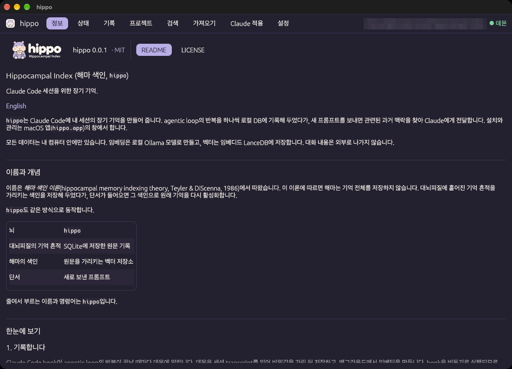
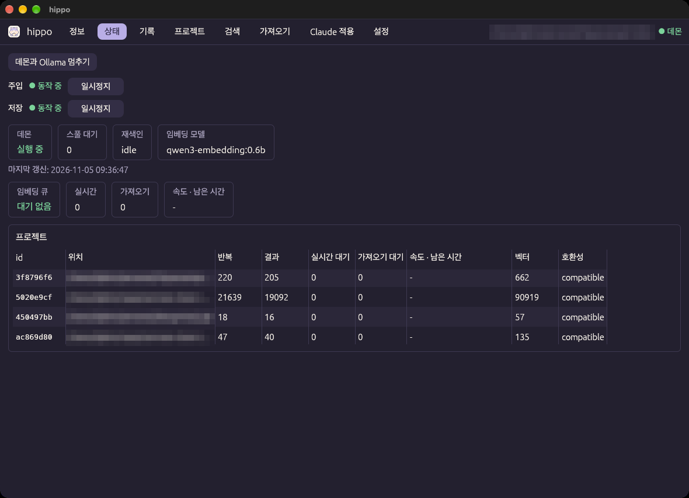
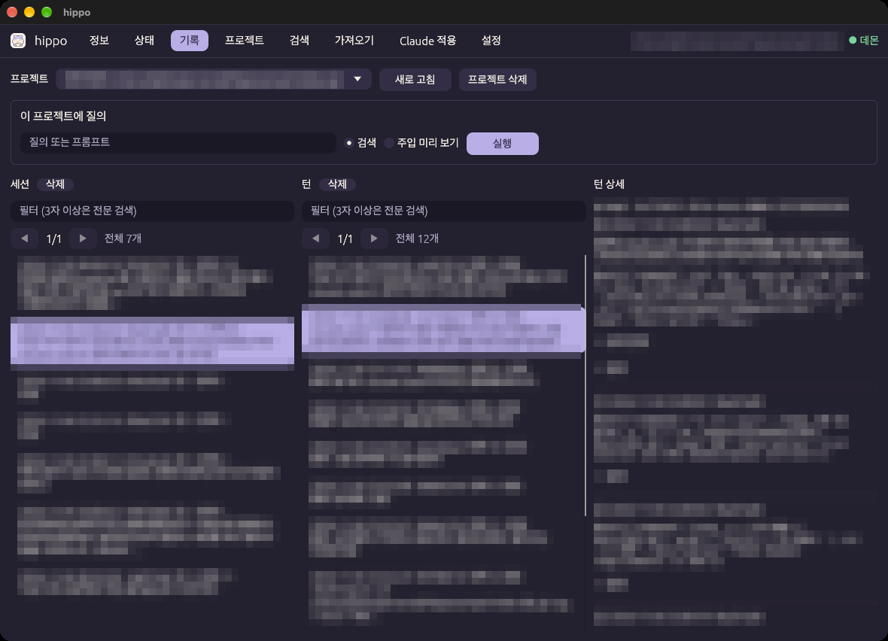
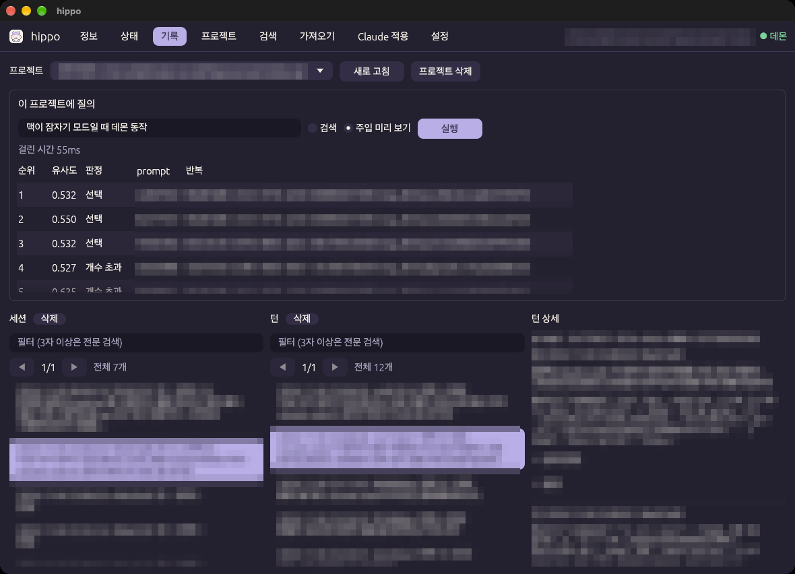
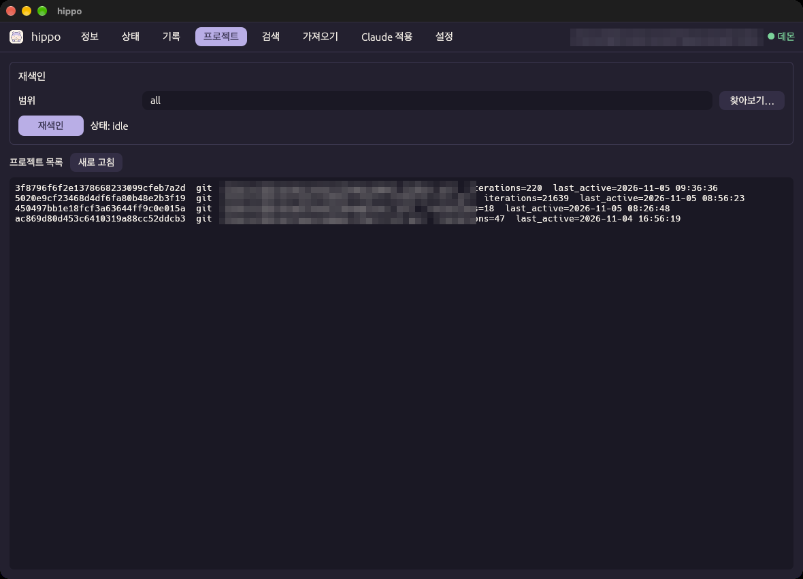
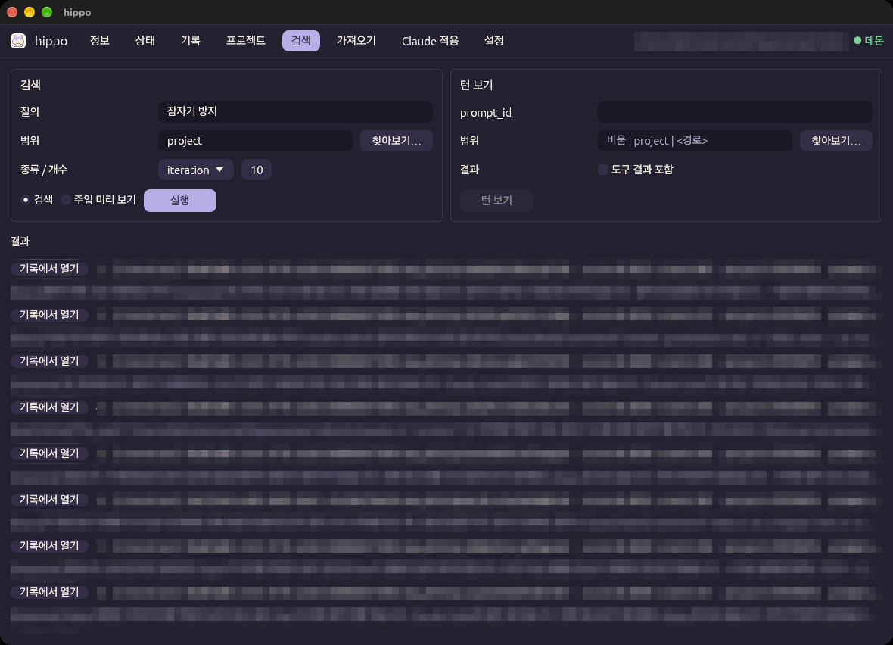
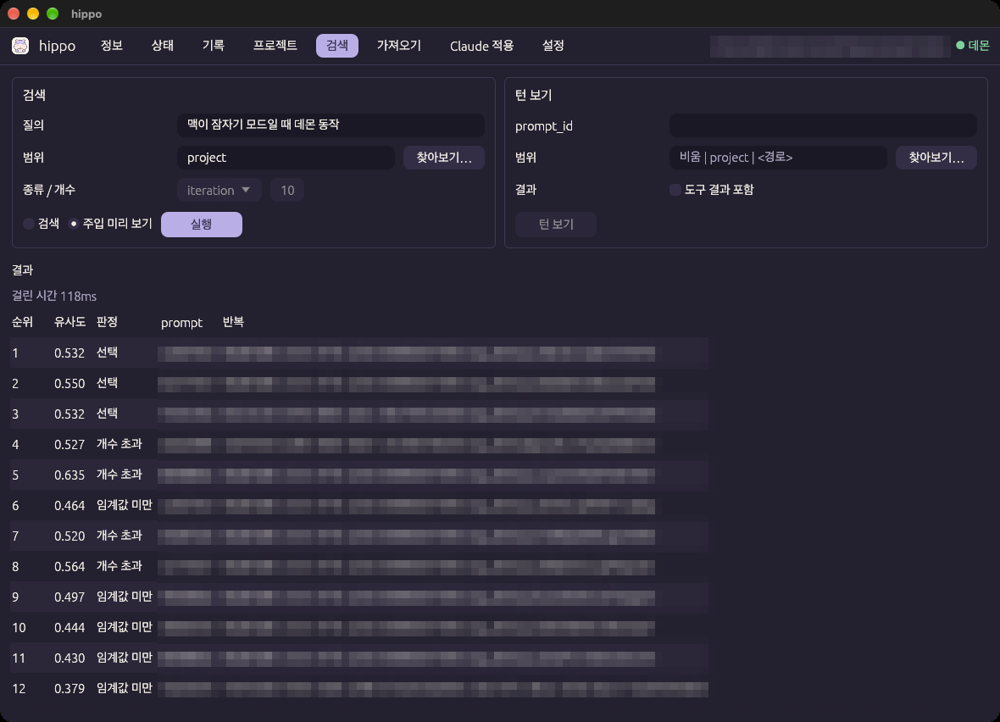
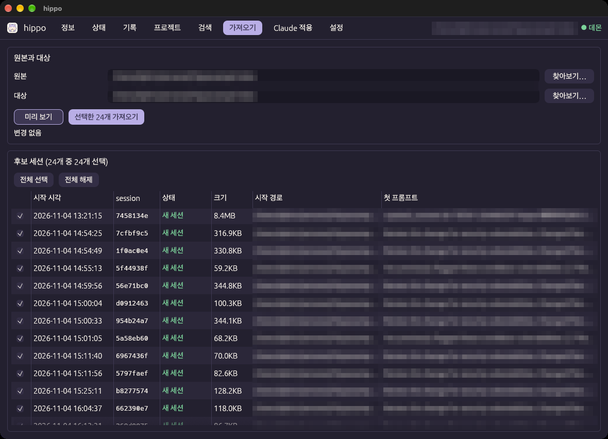
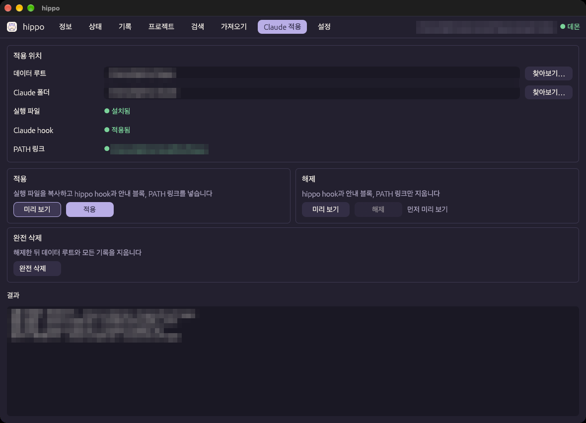
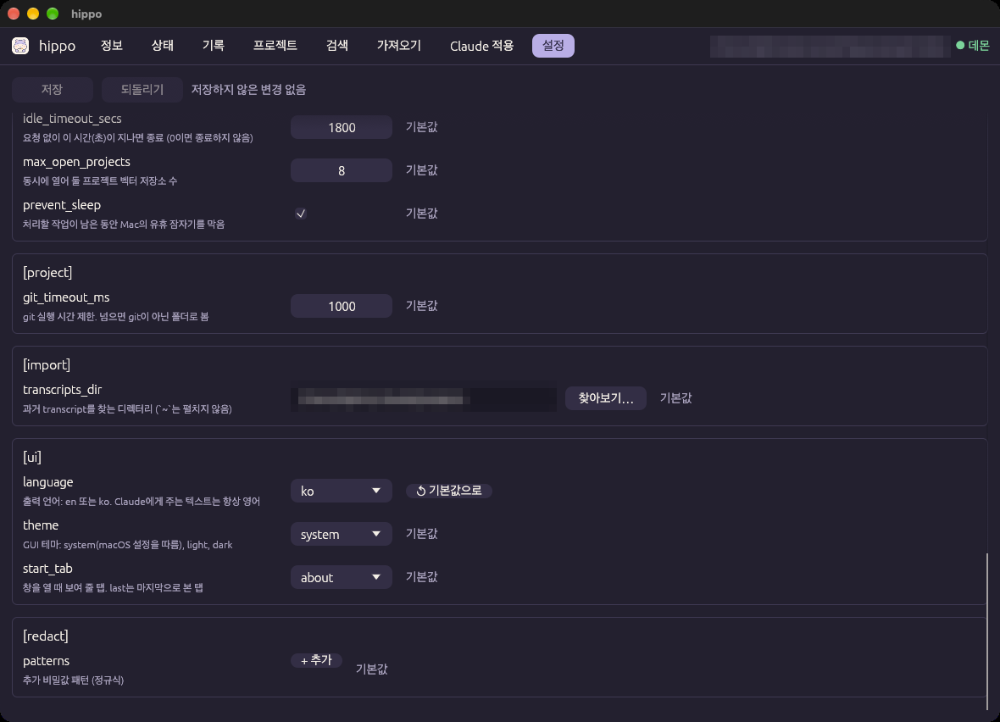

# GUI 사용법

[← README](../../README.ko.md) · [English](../en/usage.md)

설치가 끝나면 수집과 자동 주입은 알아서 동작합니다. 앱 창은 기록을 둘러보고, 검색하고, 과거 대화를 가져오고, 설정을 바꿀 때 씁니다. 설치 순서는 [시작하기](getting-started.md)를 보십시오.

> 스크린샷의 대화 내용, 프로젝트 이름과 경로는 모자이크로 가렸습니다.

## 목차

- [창 구성](#창-구성)
- [정보 탭](#정보-탭)
- [상태 탭](#상태-탭)
- [기록 탭](#기록-탭)
- [프로젝트 탭](#프로젝트-탭)
- [검색 탭](#검색-탭)
- [가져오기 탭](#가져오기-탭)
- [Claude 적용 탭](#claude-적용-탭)
- [설정 탭](#설정-탭)
- [기록 지우기](#기록-지우기)
- [Claude가 기억을 쓰는 방법](#claude가-기억을-쓰는-방법)

---

## 창 구성

- **앱 열기**: `hippo.app`을 엽니다. 터미널에서는 `hippo gui`로도 같은 창을 엽니다. 창은 네이티브 창(egui)이고, 브라우저나 웹뷰는 쓰지 않습니다.
- **위쪽 탭**: 정보, 상태, 기록, 프로젝트, 검색, 가져오기, Claude 적용, 설정.
- **처음 여는 탭**: 기본은 **정보** 탭입니다. [설정 탭](#설정-탭)의 `[ui] start_tab`에서 다른 탭이나 `last`(마지막으로 본 탭)로 바꿀 수 있습니다.
- **오른쪽 위**: 현재 폴더와 데몬 연결 상태입니다. 현재 폴더는 모든 요청의 기준 폴더이고, 경로 입력란의 기본값입니다. Finder에서 연 앱은 `/`이고, `hippo gui`는 명령을 실행한 폴더입니다.
- **찾아보기…**: 경로를 받는 입력란 옆에 있습니다. macOS 폴더 선택 창으로 폴더를 고릅니다. `~/.claude` 같은 숨김 폴더도 보입니다.
- **언어와 테마**: 창의 문구는 `[ui] language`(`en` 또는 `ko`)를 따릅니다. 색은 기본으로 macOS의 라이트·다크 모드를 따르고, `[ui] theme`으로 고정할 수 있습니다. 둘 다 [설정 탭](#설정-탭)에서 바꾸면 바로 적용됩니다.
- **데이터 루트**: 창은 설치된 실행 파일의 데이터 루트를 씁니다. 앱 안의 실행 파일처럼 설치하지 않은 실행 파일이면 `~/.local/bin/hippo` 링크가 가리키는 루트를 쓰고, 링크가 없으면 `~/.hippo`를 씁니다. 그 루트에 실행 파일이 없거나 앱과 다르면, 위쪽에 안내를 띄우고 **Claude 적용** 탭과 **정보** 탭만 열어 둡니다.

---

## 정보 탭

버전과 README, LICENSE를 보여 줍니다.

- README는 제목, 표, 코드 블록 같은 마크다운 서식으로 보여 줍니다. 그림은 보여 주지 않습니다.
- README의 문서 링크를 누르면 GitHub의 그 문서를 기본 브라우저로 엽니다.

---

## 상태 탭

데몬과 임베딩 진행 상황을 2초마다 새로 보여 줍니다.

| 영역 | 내용 |
|------|------|
| **데몬과 Ollama 멈추기** | 데몬과 `hippo`가 띄운 Ollama 서버를 지금 멈춥니다. 멈춘 뒤에는 폴링도 멈추고 **다시 시작**을 누를 때까지 기다립니다 |
| **주입 / 저장** | 자동 주입과 기록 저장을 따로 **일시정지**하거나 **재생**합니다. 아래 [일시정지](#일시정지)를 보십시오 |
| 데몬, 스풀 대기, 재색인, 임베딩 모델 | 데몬 상태, 데몬이 꺼져 있던 동안 쌓인 요청 수, 재색인 상태, 쓰는 임베딩 모델 |
| **임베딩 큐** | 모든 프로젝트의 임베딩 대기를 실시간 작업과 가져오기 작업으로 나눠 보여 줍니다. 최근 5분 동안 처리한 작업이 있으면 속도와 남은 시간도 보여 줍니다 |
| **프로젝트** 표 | 프로젝트마다 반복·결과 수, 실시간·가져오기 대기, 속도와 남은 시간, 벡터 수, 호환성(`empty`, `compatible`, `mismatch`) |
| **주입 (최근 7일)** 표 | 프로젝트마다 자동 주입 요청 수, 주입한 수(비율), 후보 없음, 무주입(사유별), 시간 초과, 오류. 그리고 에이전트가 기억을 쓴 수: **열람**(주입받은 턴을 `hippo show`로 열어 봄), **검색**(`hippo search`), **show**(그 밖의 `hippo show`) |

창이 열려 있는 동안 데몬은 유휴 종료하지 않습니다.

### 일시정지

- **주입 일시정지**: 다음 프롬프트부터 과거 기억을 주입하지 않습니다. 기록은 계속 저장합니다.
- **저장 일시정지**: 새 기록을 저장하지 않습니다. **재생**을 누르면, 열려 있던 세션은 일시정지 동안의 기록도 다음 수집 때 저장합니다.
- 두 버튼은 `config.toml`의 `[inject] enabled`, `[capture] enabled`를 바꿉니다. hook이 매번 설정을 읽으므로 데몬을 다시 시작하지 않아도 됩니다.

---

## 기록 탭

프로젝트 하나의 기록을 **세션 → 턴 → 턴 상세** 순서로 둘러봅니다.

1. 위쪽 **프로젝트**에서 프로젝트를 고릅니다. 처음에는 현재 폴더의 프로젝트가 선택됩니다.
2. **세션** 목록(최신순)에서 세션을 고릅니다.
3. **턴** 목록(시간순)에서 턴을 고릅니다. 턴마다 임베딩 상태를 `완료` 또는 `대기 n`으로 보여 줍니다.
4. **턴 상세**는 그 턴의 반복을 순서대로 보여 줍니다. 입력, 도구 호출, 응답이 나오고, 긴 도구 입력(**입력 전체**)과 도구 출력(**결과**)은 접어 둡니다.

- 목록은 50개씩 나눠 보여 줍니다. ◀ ▶로 넘깁니다.
- 목록 위의 **필터**에 글자를 넣으면 그 글자가 든 반복이 있는 세션과 턴만 남깁니다. 3자 이상이면 전문 검색을 쓰고, 그보다 짧으면 단순 포함 비교를 씁니다.
- **새로 고침**은 목록을 다시 읽습니다.

### 이 프로젝트에 질의

목록 위의 질의란에서 두 가지를 할 수 있습니다.

- **검색**: 이 프로젝트의 하이브리드 검색입니다. 결과를 누르면 그 턴을 엽니다.
- **주입 미리 보기**: 프롬프트를 보냈을 때 무엇이 주입될지 미리 계산합니다.

주입 미리 보기는 자동 주입과 같은 설정과 규칙을 씁니다. 다만 현재 세션을 제외하지 않고, 시간 예산도 적용하지 않습니다.

- 후보마다 RRF 순위, 유사도, 판정을 보여 줍니다. 판정은 `선택`, `임계값 미만`, `FTS 전용`, `같은 턴`, `길이 한도 초과`, `개수 초과` 중 하나입니다.
- 실제로 넣을 **주입 텍스트**와 걸린 시간을 함께 보여 줍니다. 주입하지 않으면 그 사유를 보여 줍니다.
- 주입이 너무 많거나 적으면 이 화면을 보면서 [설정](configuration.md)의 `[inject] threshold`를 조정합니다.

---

## 프로젝트 탭

프로젝트 목록을 보고, 벡터 색인을 다시 만듭니다.

- **프로젝트 목록**: 프로젝트 id, 종류(`git`/`dir`), 위치, 반복 수, 마지막 활동 시각.
- **재색인**: 범위(`all`, `project`, 또는 경로)의 벡터 색인을 다시 만듭니다. 임베딩 모델이나 차원을 바꿔서 호환성이 `mismatch`가 되었을 때 씁니다. 재색인 중에도 기존 색인으로 검색할 수 있습니다. 자세한 내용은 [설정의 임베딩 모델 바꾸기](configuration.md#임베딩-모델이나-벡터-db-바꾸기)를 보십시오.

---

## 검색 탭

모든 범위에서 검색하거나, 주입을 미리 보거나, 턴 하나를 통째로 봅니다. CLI의 `hippo search`, `hippo show`와 같습니다.

**검색** 카드:

| 입력 | 값 |
|------|----|
| 질의 | 찾을 내용 |
| 범위 | `project`(현재 폴더의 프로젝트), `all`(모든 프로젝트), 또는 경로 |
| 종류 / 개수 | `iteration`(반복), `result`(도구 출력), `both` / 결과 수(기본 10) |

**검색**과 **주입 미리 보기** 중 하나를 고른 뒤 **실행**을 누릅니다.

- **검색**: 결과마다 RRF 점수, 벡터 유사도(`sim=-`이면 키워드로만 찾은 결과), 프로젝트 id, `prompt_id`, 미리 보기가 나옵니다. 반복 결과의 **기록에서 열기**를 누르면 [기록 탭](#기록-탭)에서 그 프로젝트와 턴을 엽니다.
- **주입 미리 보기**: 질의를 프롬프트로 보냈을 때 무엇이 주입될지 보여 줍니다. 결과 형식은 [기록 탭의 주입 미리 보기](#이-프로젝트에-질의)와 같습니다. 자동 주입은 프로젝트 하나 안에서만 하므로, 범위는 `project`나 경로여야 합니다. 범위가 `all`이거나 비어 있으면 **실행**을 누를 수 없고 그 사유가 나옵니다. 종류와 개수는 쓰지 않습니다.

**턴 보기** 카드는 `prompt_id`로 턴 하나를 보여 줍니다. 범위를 비우면 현재 프로젝트를 먼저 찾고, 없으면 나머지 프로젝트를 최근에 쓴 순서로 찾습니다. **도구 결과 포함**을 켜면 도구 출력 원문까지 보여 줍니다.

---

## 가져오기 탭

`hippo`를 설치하기 전의 대화나, 폴더를 옮기기 전의 대화를 기억으로 가져옵니다. Claude Code가 남긴 과거 transcript(`~/.claude/projects/*/*.jsonl`)를 읽습니다.

1. **원본**: 대화를 진행했던 폴더입니다. 폴더가 지금 없어도 됩니다. git 저장소이면 그 저장소의 worktree에서 연 세션도 포함합니다.
2. **대상**: 기록을 넣을 프로젝트의 폴더입니다. 보통 원본과 같습니다. 폴더를 옮겼다면 원본에 이전 경로, 대상에 새 경로를 넣습니다.
   - 두 입력란 오른쪽의 **프로젝트** 목록에서 저장된 프로젝트를 고르면, 그 프로젝트의 폴더 경로가 입력란에 들어갑니다.
3. **미리 보기**를 누릅니다. 아무것도 바꾸지 않고, 할 일(프로젝트 생성, 위치 변경, 병합)과 **후보 세션** 표를 보여 줍니다.
4. 표에서 가져올 세션을 고릅니다. `새 세션`과 `실시간만`인 세션이 처음에 선택됩니다.
5. **선택한 N개 가져오기**를 누릅니다. **멈춤**을 누르면 지금 처리 중인 세션을 마친 뒤 멈춥니다.

후보 세션 표의 **상태**는 다음 중 하나입니다.

| 상태 | 뜻 |
|------|----|
| `새 세션` | 아직 저장하지 않은 세션 |
| `실시간만` | 실시간 수집이 시작된 뒤만 저장된 세션. 앞부분을 채웁니다 |
| `가져옴` | 이미 모두 가져온 세션 |
| `다른 프로젝트` | 다른 프로젝트에 고정된 세션. 건너뜁니다 |

- 첫 프롬프트는 비밀값을 가리고 앞부분만 보여 줍니다.
- 가져온 기록의 임베딩 진행은 [상태 탭](#상태-탭)의 **가져오기** 대기로 볼 수 있습니다. 데몬은 실시간 작업을 가져오기 작업보다 먼저 처리하므로, 가져오는 동안에도 새 대화는 늦지 않게 저장되고 검색됩니다.
- 중간에 멈춰도 됩니다. 다시 가져오면 끝난 세션은 건너뛰고 남은 세션부터 이어서 처리합니다.

세부 규칙(병합, fork 복사본, 보류한 반복)은 [CLI 참고의 `import`](cli.md#import)를 보십시오.

---

## Claude 적용 탭

Claude Code에 `hippo`를 적용하거나 해제하고, 데이터를 완전히 지웁니다.

- **적용 위치**: 데이터 루트와 Claude 폴더를 고르고, 실행 파일·Claude hook·PATH 링크의 상태를 봅니다.
- **적용 / 해제**: 먼저 **미리 보기**로 바뀔 내용을 확인합니다. 같은 입력으로 미리 보기를 한 뒤에만 **적용**이나 **해제**를 누를 수 있고, 확인을 한 번 더 받습니다.
- **완전 삭제**: 해제한 뒤 데이터 루트와 모든 기록을 지웁니다. 되살릴 수 없습니다.

순서와 각 버튼이 바꾸는 파일은 [시작하기](getting-started.md#4-claude에-적용하기)를 보십시오.

---

## 설정 탭

`config.toml`의 모든 키를 설명, 기본값 여부와 함께 보여 줍니다.

- 값을 고친 뒤 **저장**을 누릅니다. **되돌리기**는 저장하지 않은 변경을 버립니다.
- 키 옆의 **↺ 기본값으로**를 누르면 기본값으로 돌아가고, 저장할 때 파일에서 그 키를 지웁니다.
- 저장할 때는 바꾼 키만 고치고, 파일에 직접 쓴 주석은 그대로 둡니다. 저장하기 전에 결과를 검사하며, 잘못된 설정은 쓰지 않습니다.
- 데몬을 다시 시작해야 하는 변경이면 **데몬 다시 시작** 버튼이 나타납니다. 재색인이 필요한 변경이면 그것도 알려 줍니다.
- `[ui] language`와 `[ui] theme`은 저장하면 바로 바뀝니다. `[ui] start_tab`은 다음에 창을 열 때 적용됩니다.

키마다의 뜻은 [설정](configuration.md)에 있습니다.

---

## 기록 지우기

[기록 탭](#기록-탭)에서 지울 수 있습니다.

| 버튼 | 지우는 범위 |
|------|-------------|
| **세션** 옆의 **삭제** | 선택한 세션 하나 |
| **턴** 옆의 **삭제** | 선택한 턴 하나. 프로젝트 안 모든 세션에서 그 `prompt_id`의 반복을 모두 지웁니다 |
| **프로젝트 삭제** | 프로젝트 전체 |

버튼을 누르면 먼저 지울 내용(프로젝트 id와 위치, 세션·턴·반복·결과 수)을 보여 주고 확인을 받습니다.

- 지운 기록은 따로 남기지 않으며, 되살릴 수 없습니다.
- 도구 출력은 남은 기록 중 어디에서도 참조하지 않을 때만 지웁니다. 같은 출력을 여러 세션이 함께 쓰는 경우가 있기 때문입니다.
- 세션을 지우면 그 세션을 어디까지 읽었는지도 함께 지웁니다. 아직 열려 있는 세션이면 다음 hook부터 다시 저장합니다. 과거 세션도 다시 가져오면 돌아옵니다.
- 프로젝트를 지운 뒤 같은 폴더에서 새 세션을 열면 새 프로젝트로 쌓입니다.
- 재색인 중에는 지우지 않습니다. 임베딩 묶음을 처리하는 중이면 그 묶음이 끝날 때까지 기다린 뒤 지웁니다. 긴 도구 출력이 많은 묶음은 수십 초가 걸릴 수 있습니다.

---

## Claude가 기억을 쓰는 방법

- **자동 주입**: 프롬프트를 보낼 때마다 같은 프로젝트의 다른 세션에서 가장 잘 맞는 턴 몇 개를 찾아 Claude에게 전달합니다. 주입 규칙은 [구조와 동작](architecture.md#4-기억을-쓰는-방법)에 있습니다.
- **Claude가 직접 검색**: 자동 주입은 몇 개만 전달합니다. 더 찾아봐야 할 때는 Claude가 `hippo search`와 `hippo show`를 직접 실행합니다. 이 방법을 알려 주는 안내 블록은 **적용**이 `CLAUDE.md`에 넣으므로, 따로 적을 필요가 없습니다.
- **직접 물어보기**: Claude에게 "지난번에 토큰 만료 버그를 어떻게 고쳤는지 찾아봐"처럼 요청하면, Claude가 위 명령으로 찾아봅니다.
